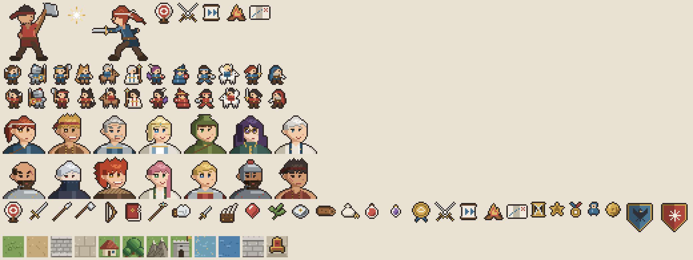
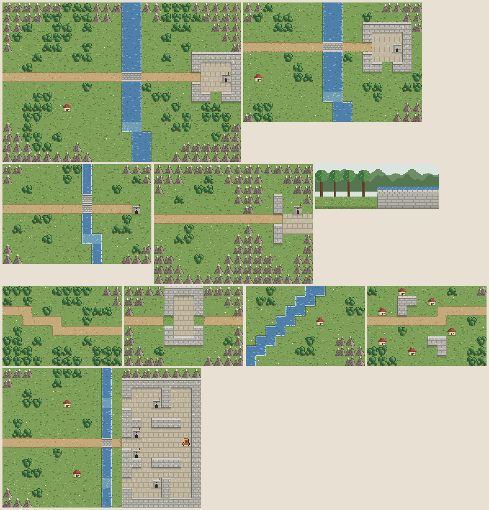

# 像素素材

状态：UI 设计稿用的原型素材。所有 PNG 都由 [`gen_art.py`](gen_art.py) 用代码逐像素画出，全部原创，没有使用火焰纹章的角色、标志或美术资产。

[UI 设计画板](https://claude.ai/artifact/27oMCYU8APZE8R1ukpj2qn)里的图就是这些 PNG 的上传副本。画板默认只有所有者能打开，要给别人看，需在页面的分享菜单里开启。



## 重新生成

只用素材的话什么都不用装，PNG 已经在 `png/` 里。修改或新增素材需要 Python 3 和 Pillow（本次在 Python 3.11.2、Pillow 9.4.0 验证）。

在项目根目录运行：

```bash
# 覆盖 design/pixel-art/png/ 和两张总览图
python3 design/pixel-art/gen_art.py

# 输出到其他目录，再和现有文件比较
python3 design/pixel-art/gen_art.py /tmp/pixel-art
diff -r design/pixel-art/png /tmp/pixel-art/png
```

唯一的参数是输出根目录，省略时为脚本所在目录。素材写入 `<根目录>/png/`，总览图 `contact.png`（4 倍）和 `contact_maps.png`（2 倍）写入根目录。

所有随机取值都用固定种子，每次运行的像素完全相同；Pillow 版本相同时，文件也逐字节相同。

## 显示规则

- PNG 都是 1 倍原图。放大只用整数倍，并设置 `image-rendering: pixelated`，否则像素会被插值模糊或宽窄不一。
- 画板中的用法：地图和地图单位多为 3 倍（一格 48 px），头像 2–3 倍，图标和纹章多为 2 倍，交战演出 4 倍。小地图是缩小显示，不受整数倍限制。

## 文件

### 地图单位 `unit_<兵种>_<阵营>.png`

16×16。`ally` 为己方：蓝色、面朝右，发色对应示例名册中该兵种的角色；`enemy` 为敌方：红色、面朝左。

每条职业路线共用一张（`frontend/src/assets.ts::spriteFor` 按 `CLASSES[id].route` 取图），五个阶位外观相同，专用美术以后再补。

| 键 | 职业路线 | 键 | 职业路线 |
| --- | --- | --- | --- |
| `sword` | 剑术 | `archer` | 弓术 |
| `axe` | 斧战 | `mage` | 魔法 |
| `armor` | 重甲 | `cleric` | 治疗 |
| `cav` | 骑乘 | `thief` | 机巧（潜行）：兜帽、遮面、短刀 |
| `peg` | 飞行 | `monk` | 格斗：头带、铁拳套 |
| `beast` | 兽人：尖耳、尾巴、爪 | `dragon` | 龙人：角、翼、龙石 |

### 头像 `por_<角色>.png`

32×32。总览图第四行从左到右是下表左半部分，第五行是右半部分。

| 键 | 角色 | 兵种 | 键 | 角色 | 兵种 |
| --- | --- | --- | --- | --- | --- |
| `erin` | 艾琳 | 剑士 | `gustav` | 古斯塔夫 | 重甲兵 |
| `karl` | 卡尔 | 斧兵 | `ren` | 雷恩 | 剑士 |
| `victor` | 维克托 | 骑兵 | `ig` | 伊格 | 斧兵 |
| `lina` | 莉娜 | 天马骑士 | `mira` | 米拉 | 修士 |
| `owen` | 欧文 | 弓兵 | `roland` | 罗兰 | 骑兵 |
| `sera` | 塞拉 | 魔道士 | `brock` | 布洛克 | 重甲兵（黑松隘口敌方主将） |
| `noah` | 诺亚 | 修士 | `grunt_axe` | 灰岩斧兵 | 通用敌兵 |

### 图标 `ico_<键>.png`

- 16×16：`sword` 剑、`lance` 枪、`axe` 斧、`bow` 弓、`tome` 理魔法、`staff` 杖、`fist` 拳套、`dagger` 短刀、`beast` 兽爪、`dragon` 龙石、`vulnerary` 伤药、`elixir` 能力药、`seal` 转职印。
- 16×16 军营行动：`act_sortie` 出击、`act_sweep` 扫荡、`act_train` 训练、`act_rest` 休整、`act_travel` 游历。
- 12×12 资源：`hourglass` 行动日、`coin` 金币、`bexp` 奖励经验、`medal` 竞技场勋章、`roster` 名册。

### 纹章 `crest_<键>.png`

24×24：`raven` 灰鸦军团（示例中的玩家军团，蓝），`frost` 霜狼骑团（示例对手，红）。

### 地图 `map_<键>.png`

每格 16 px。下表顺序与地图总览图一致，总览图第二行最右是交战演出背景 `stage_pass`。



| 键 | 格数 | 画板里的名字 | 用在 |
| --- | --- | --- | --- |
| `pinepass` | 24×16 | 黑松隘口 | 战斗、交战演出、观战、回放、界面规范 |
| `ford` | 18×12 | — | 画板未使用 |
| `plains` | 15×10 | 平原会战 | 竞技场禁用、部署，防守地图选项 |
| `pass` | 16×12 | 山间隘口 | 防守设置 |
| `woods` | 12×8 | 林中遭遇 | 防守地图选项 |
| `mine` | 12×8 | — | 画板未使用 |
| `bend` | 12×8 | — | 画板未使用 |
| `ruins` | 12×8 | 王城 | 防守地图选项（画板里的王城缩略图） |
| `castle` | 20×14 | — | 竞技场「王城」：禁用、部署、战斗、防守设置（画板之后新增） |

布局写在 `gen_art.py` 的 `MAPS` 里：每张图是一组等长的字符行，前面的数字是纹理随机种子。字符与 [03 战斗规则](../../docs/03-combat.md)的地形表一致：

| 字符 | 地形 | 字符 | 地形 |
| --- | --- | --- | --- |
| `.` | 平地 | `m` | 山地 |
| `r` | 道路 | `F` | 堡垒 |
| `b` | 桥 | `s` | 浅滩 |
| `p` | 石地板 | `w` | 水域 |
| `v` | 村庄 | `#` | 墙壁 |
| `f` | 森林 | `T` | 王座 |

素材总览图的最后一行是这 12 种地形的单格样例，顺序与地形表相同。王座出现在 `castle`（王座在 `(18,7)`）和随机地图中；地图总览图的最后一行是 `castle`。

### 交战演出

- `fight_erin.png`、`fight_axe.png`：44×44 侧视人物，艾琳和灰岩斧兵。
- `fx_spark.png`：19×19 命中火花。
- `stage_pass.png`：200×72 演出背景，林地与石墙。

## 修改与新增

| 要改的素材 | `gen_art.py` 中的位置 |
| --- | --- |
| 地图 | `MAPS`，键名即文件名 |
| 地形画法 | `PAINTERS`、`TERRAIN_ORDER`；新增地形还要同步 03 地形表和 `backend/common/maps/map.ts` |
| 地图单位 | `UNITS` 字符画，字符对应 `BASE` 调色板；阵营色在 `FACTIONS`，己方发色在 `UNIT_HAIR_ALLY` |
| 头像 | `PORTRAITS`，组合 `HAIR_STYLES` 发型、`OUTFITS` 服装、`ACCESSORIES` 配饰和配色 |
| 图标 | `ICONS16`、`ICONS12` 字符画；训练和金币图标由 `target16()`、`coin12()` 绘制 |
| 纹章 | `build_crests()` |
| 交战演出 | `fighter_erin()`、`fighter_axe()`、`spark()`、`backdrop()` |

改完重新生成，先看两张总览图。

## 与随机地图生成器的关系

两边使用同一张地形表，字符和地形种类都一致；[随机地图生成器](../../docs/10-random-map-generator.md)的 SVG 预览配色也取自这里的色板。`tools/mapgen` 的测试会读取本脚本的 `PAINTERS`，字符对不上时测试失败。

这里的示例地图仍是为设计稿手写的布局。生成器输出的地图可以交给 `render_map()` 画成同样的像素风格，但脚本还没有直接读取地图 JSON 的命令。
