# 当前全部职业 × FE-Repo 动画对照

已核对当前代码中的 **77 个在用职业、12 条路线**，按真实名称、可用武器和现有像素形象匹配；不含停用职业和旧别名。建议归为 **37 组动作／改绘家族**，主参考来自 **52 个资源包**，连同补充参考共 **60 个包、111 个不同 GIF**。

打开 [可筛选的图文对照页](classes.html)：每个职业左边为当前游戏像素形象，右边为候选 GIF；下拉可切换该职业的其他武器动作及补充参考。动画手动播放，可离线浏览。

- **轮廓相近（4 个）**：体型、步行／骑乘方式接近，仍需匹配当前职业的配色和装束。
- **局部改绘（55 个）**：可复用基本动作，修改头饰、盔甲、披风、武器外形等。
- **较大重绘（18 个）**：坐骑／车体／兽体／翼尾等轮廓差异明显，候选用于动作参考。

**77 个职业的 162 个攻击武器组合已全部接入：155 个使用 FE-Repo 动画，飞鸵三阶新增的 7 个剑／斧／魔法组合使用项目自绘的 16 帧动作。** 治疗杖只在地图演出，不计入攻击动作。拳击使用真实攻击段；龙人五职业使用幼龙、翼龙、红龙、魔龙和白龙的龙形攻击。

当前复用的 FE 来源装束尚未全部改成统一职业服装；右列的改绘程度描述这项美术差异，并非缺少可播放的攻击动画。实际转换清单及游戏鸣谢见 [../fe-anims](../fe-anims/README.md)，项目自绘见 [../battle-sheets](../battle-sheets/README.md)。完整参考署名见 [CLASS-CREDITS.md](CLASS-CREDITS.md)，逐个武器的来源与校验值见 [class-map.json](class-map.json)。

## 剑术（11）

| 当前职业 | 当前像素图 | 对应 GIF／资源家族 | 武器动作 | 改绘与共用方案 |
|---|---|---|---|---|
| **平民** `commoner` | 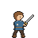 | [村民与贵族 · Sword](class-previews/G001.gif) [S01 署名](CLASS-CREDITS.md#S01) | [剑](class-previews/G001.gif)、[枪](previews/A03.gif)、[斧](class-previews/23429f7a3995ce95.gif)、[弓](class-previews/G029.gif)、[拳](class-previews/G002.gif)、杖（地图治疗）、[魔法](class-previews/G006.gif) | **局部改绘**。攻击动作已按实际武器补齐；同组职业复用动作。当前保留各来源人物的装束并适配阵营色，尚未把不同武器包统一重绘为同一套服装。拳击采用 Boxer 的真实攻击段，非徒手待机。 同组：贵族。 |
| **贵族** `noble` |  | [村民与贵族 · Sword](class-previews/G003.gif) [S02 署名](CLASS-CREDITS.md#S02) | [剑](class-previews/G003.gif)、[枪](class-previews/G004.gif)、[斧](class-previews/23429f7a3995ce95.gif)、[弓](class-previews/G005.gif)、[拳](class-previews/G002.gif)、杖（地图治疗）、[魔法](class-previews/G006.gif) | **局部改绘**。攻击动作已按实际武器补齐；同组职业复用动作。当前保留各来源人物的装束并适配阵营色，尚未把不同武器包统一重绘为同一套服装。拳击采用 Boxer 的真实攻击段，非徒手待机。 同组：平民。 |
| **斗士** `gladiator` | 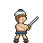 | [角斗士与土匪 · Axe](class-previews/G007.gif) [S03 署名](CLASS-CREDITS.md#S03) | [剑](class-previews/G008.gif)、[斧](class-previews/G007.gif)、[拳](class-previews/42297d62f7944a67.gif) | **局部改绘**。攻击动作已按实际武器补齐；同组职业复用动作。当前保留各来源人物的装束并适配阵营色，尚未把不同武器包统一重绘为同一套服装。拳击采用 Strong Guy 的真实攻击段，非徒手待机。 同组：土匪。 |
| **剑客** `swordsman` | 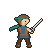 | [剑客与武士 · Sword](previews/A01.gif) [S04 署名](CLASS-CREDITS.md#S04) | [剑](previews/A01.gif)、[枪](class-previews/G080.gif) | **局部改绘**。攻击动作已按实际武器补齐；同组职业复用动作。当前保留各来源人物的装束并适配阵营色，尚未把不同武器包统一重绘为同一套服装。 同组：侍道、刀剑将领。 |
| **侍道** `shido` | 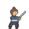 | [剑客与武士 · Sword](class-previews/G010.gif) [S05 署名](CLASS-CREDITS.md#S05) | [剑](class-previews/G010.gif)、[枪](class-previews/G080.gif) | **局部改绘**。攻击动作已按实际武器补齐；同组职业复用动作。当前保留各来源人物的装束并适配阵营色，尚未把不同武器包统一重绘为同一套服装。 同组：剑客、刀剑将领。 |
| **舞者** `dancer` | 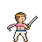 | [舞者与神乐 · Sword](class-previews/G011.gif) [S06 署名](CLASS-CREDITS.md#S06) | [剑](class-previews/G011.gif)、[弓](class-previews/004643696930ec84.gif) | **局部改绘**。攻击动作已按实际武器补齐；同组职业复用动作。当前保留各来源人物的装束并适配阵营色，尚未把不同武器包统一重绘为同一套服装。 同组：神乐神将。 |
| **刀剑将领** `swordmaster` | 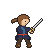 | [剑客与武士 · Sword](class-previews/G010.gif) [S05 署名](CLASS-CREDITS.md#S05) | [剑](class-previews/G010.gif)、[枪](class-previews/G080.gif) | **局部改绘**。攻击动作已按实际武器补齐；同组职业复用动作。当前保留各来源人物的装束并适配阵营色，尚未把不同武器包统一重绘为同一套服装。 同组：剑客、侍道。 |
| **刃辉神将** `blade` |  | [光辉剑将 · Sword (Tyrfing)](class-previews/G012.gif) [S07 署名](CLASS-CREDITS.md#S07) | [剑](class-previews/G012.gif)、[枪](class-previews/G013.gif) | **局部改绘**。披风与额饰适合高阶剑将；改银白金边板甲、宝石冠并加轻光点。目录剑／枪俱全，不能用放大比例代替升级造型。 |
| **神乐神将** `apsara` | 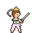 | [舞者与神乐 · Sword](class-previews/G011.gif) [S06 署名](CLASS-CREDITS.md#S06) | [剑](class-previews/G011.gif)、[弓](class-previews/004643696930ec84.gif) | **较大重绘**。攻击动作已按实际武器补齐；同组职业复用动作。当前保留各来源人物的装束并适配阵营色，尚未把不同武器包统一重绘为同一套服装。 同组：舞者。 |
| **佣兵** `mercenary` | 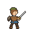 | [佣兵与勇者 · Sword](class-previews/G014.gif) [S08 署名](CLASS-CREDITS.md#S08) | [剑](class-previews/G014.gif) | **局部改绘**。佣兵持剑、厚护肩可共用；补现有橄榄头巾、破斗篷和腰包，去掉与现有造型不符的装饰。当前只要求剑。 同组：勇者。 |
| **勇者** `hero` |  | [佣兵与勇者 · Sword](class-previews/G015.gif) [S09 署名](CLASS-CREDITS.md#S09) | [剑](class-previews/G015.gif)、[斧](class-previews/G016.gif) | **局部改绘**。剑／斧动画齐全；换成现有酒红长披风、锁子甲金纹罩袍与额前发带。原包有盾，若保留当前无盾外观需逐帧去盾并补遮挡区域。 同组：佣兵。 |

## 弓术（8）

| 当前职业 | 当前像素图 | 对应 GIF／资源家族 | 武器动作 | 改绘与共用方案 |
|---|---|---|---|---|
| **猎兵** `hunter` | 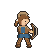 | [猎弓 · Bow](class-previews/G029.gif) [S17 署名](CLASS-CREDITS.md#S17) | [剑](class-previews/G014.gif)、[弓](class-previews/G029.gif) | **局部改绘**。攻击动作已按实际武器补齐；同组职业复用动作。当前保留各来源人物的装束并适配阵营色，尚未把不同武器包统一重绘为同一套服装。 同组：弓箭手。 [补充参考](class-previews/G092.gif)：同为步行弓手且有 Sword（tatata）可作补剑骨架；必须重绘成本职业衣帽，不能当作主源已具备剑动画。供体基础 IS，Edit by ShadowAllyX；保留各变体完整署名。 |
| **弓箭手** `archer` |  | [猎弓 · Bow](previews/B08.gif) [S20 署名](CLASS-CREDITS.md#S20) | [弓](previews/B08.gif) | **局部改绘**。改绿尖顶毡帽并插红羽、皮护胸和背箭袋；保留步行弓动作。 同组：猎兵。 |
| **战车兵** `charioteer` |  | [马拉战车 · Bow](class-previews/G040.gif) [S23 署名](CLASS-CREDITS.md#S23) | [弓](class-previews/G040.gif) | **较大重绘**。检索 chariot/wagon/cart/ballista 未找到对应马拉双轮弓战车；此源仅供马和骑射动作。必须把跨骑人改车中站姿，新增双轮车厢、前辕、挽具及轮转/车震全帧；不能把现成骑射当战车完成品。 [补充参考](class-previews/G093.gif)：车体结构参考而非可直接复用战车：FE5 Ballista 的轮架/木架可借鉴，仍需重画双轮车厢与马挽具；弩炮发射不可冒充手弓。README：Base ballista by IS；Repalette and helmeted by Pushwall；Spud, Ren_Ookami 仅署名 Catapult variant。 |
| **狙击手** `sniper` | 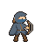 | [蒙面弓手 · Bow](class-previews/G043.gif) [S25 署名](CLASS-CREDITS.md#S25) | [弓](class-previews/G043.gif) | **局部改绘**。保留蒙面弓手，补灰蓝兜帽长斗篷、长风衣及斜带；兜帽和长衣须逐帧跟随拉弓。 |
| **森林骑士** `forest_knight` | 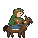 | [骑射晋阶 · Bow](class-previews/G044.gif) [S26 署名](CLASS-CREDITS.md#S26) | [剑](class-previews/G045.gif)、[弓](class-previews/G044.gif) | **局部改绘**。真正骑马弓剑双修底稿；深棕马，骑手改皮甲、绿披风及放下的兜帽、叶冠。剑选原 Sword 保持 IS 基础版本。 同组：弓骑士。 |
| **宗师射手** `marksman` |  | [礼帽射手 · Bow](class-previews/G057.gif) [S31 署名](CLASS-CREDITS.md#S31) | [弓](class-previews/G057.gif) | **局部改绘**。保留高级步行弓动作，宽檐羽帽、酒红燕尾衣、金扣马甲与白领巾袖口、金箭袋；逐帧补衣尾摆动。 |
| **弓骑士** `bow_knight` | 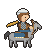 | [骑射晋阶 · Bow](class-previews/G044.gif) [S26 署名](CLASS-CREDITS.md#S26) | [剑](class-previews/G045.gif)、[弓](class-previews/G044.gif) | **局部改绘**。复用森林骑士同套马背剑弓动作；灰马、轻锁甲皮护肩、护颈轻盔及金长围巾，围巾须跟随运动。 同组：森林骑士。 |
| **绝祸神将** `calamity` |  | [兜帽暗影 · Bow](class-previews/G025.gif) [S14 署名](CLASS-CREDITS.md#S14) | [剑](class-previews/G026.gif)、[弓](class-previews/G025.gif) | **较大重绘**。与探影者共用兜帽剑／弓动作；逐帧改紫黑法衣、破边斗篷、发光符纹和暗紫悬环，轮廓与特效改动较大。 同组：探影者、刺客。 |

## 重甲（6）

| 当前职业 | 当前像素图 | 对应 GIF／资源家族 | 武器动作 | 改绘与共用方案 |
|---|---|---|---|---|
| **士兵** `lancer` | 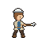 | [轻装士兵 · Lance](previews/A03.gif) [S18 署名](CLASS-CREDITS.md#S18) | [剑](class-previews/G031.gif)、[枪](previews/A03.gif)、[斧](class-previews/beded9bb239c21e9.gif) | **局部改绘**。攻击动作已按实际武器补齐；同组职业复用动作。当前保留各来源人物的装束并适配阵营色，尚未把不同武器包统一重绘为同一套服装。 |
| **重装步兵** `knight` |  | [板甲步兵 · Lance](previews/C11.gif) [S21 署名](CLASS-CREDITS.md#S21) | [剑](class-previews/G035.gif)、[枪](previews/C11.gif)、[斧](class-previews/G036.gif) | **轮廓相近**。板甲步兵基本轮廓可复用；统一银钢色、阵营腰带，将盾改鸢盾并掀起面甲。 |
| **巨型重甲兵** `dreadnought` | 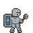 | [塔盾重甲 · Axe (Swing)](class-previews/G046.gif) [S27 署名](CLASS-CREDITS.md#S27) | [枪](class-previews/G047.gif)、[斧](class-previews/G046.gif) | **局部改绘**。保留巨大重甲与盾的骨架，铁黑超大肩甲、视缝桶盔和阵营塔盾；塔盾要加高并修遮挡，斧选挥砍避开链斧。 同组：要塞。 |
| **铁甲骑兵** `cataphract` | 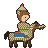 | [重骑晋阶 · Lance](previews/C06.gif) [S30 署名](CLASS-CREDITS.md#S30) | [剑](class-previews/G055.gif)、[枪](previews/C06.gif)、[斧](class-previews/G056.gif) | **局部改绘**。保留重骑人马结构，把板甲纹理改连续鳞甲，马颈到腿部均覆盖；骑手尖顶护颈垂帘盔加红缨。需逐帧改甲纹和马腿遮挡。 同组：奥利哈铁骑、英勇骑士、烈骏神将。 |
| **要塞** `fortress` | 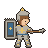 | [塔盾重甲 · Lance (Chainless)](class-previews/G047.gif) [S27 署名](CLASS-CREDITS.md#S27) | [枪](class-previews/G047.gif)、[斧](class-previews/G046.gif) | **局部改绘**。复用巨型重甲兵底稿，改石灰金边甲、高金冠；盾扩成城垛顶巨塔盾并修枪、手与盾的遮挡。 同组：巨型重甲兵。 |
| **将军** `general` |  | [披风将军 · Lance](class-previews/G058.gif) [S32 署名](CLASS-CREDITS.md#S32) | [枪](class-previews/G058.gif)、[斧](class-previews/G059.gif) | **局部改绘**。重甲披风基本结构复用；金边重铠、红缨盔，将盾改金边圆盾并缩小；斧用 Swing，避免链武器改变原设定。 |

## 骑乘（8）

| 当前职业 | 当前像素图 | 对应 GIF／资源家族 | 武器动作 | 改绘与共用方案 |
|---|---|---|---|---|
| **飞鸵兵** `ornius_rider` | 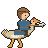 | [飞鸵三阶 · Lance](class-previews/G032.gif) [S19 署名](CLASS-CREDITS.md#S19) | [剑](../battle-sheets/ornius_rider-sword.gif)、[枪](class-previews/G032.gif)、[斧](../battle-sheets/ornius_rider-axe.gif) | **局部改绘**。枪沿用 Chocobo 鸟骑来源；新增剑、斧采用项目自绘图层，保留本职业鸟形坐骑、盔甲与装饰。项目动作共 16 帧，含蓄力、命中和收招。 同组：骑甲鸵兵、神鸵兵。 |
| **轻骑兵** `cavalier` |  | [骑兵晋阶 · Lance](class-previews/G037.gif) [S22 署名](CLASS-CREDITS.md#S22) | [剑](class-previews/G038.gif)、[枪](class-previews/G037.gif)、[斧](class-previews/G039.gif) | **轮廓相近**。保留轻甲骑马及三武器动作；改栗马、阵营鞍褥、皮甲短衣与圆盔小缨。 同组：荣光骑士。 |
| **骑甲鸵兵** `armored_ornius` |  | [飞鸵三阶 · Lance](class-previews/G032.gif) [S19 署名](CLASS-CREDITS.md#S19) | [剑](../battle-sheets/armored_ornius-sword.gif)、[枪](class-previews/G032.gif)、[斧](../battle-sheets/armored_ornius-axe.gif) | **局部改绘**。枪沿用 Chocobo 鸟骑来源；新增剑、斧采用项目自绘图层，保留本职业鸟形坐骑、盔甲与装饰。项目动作共 16 帧，含蓄力、命中和收招。 同组：飞鸵兵、神鸵兵。 |
| **荣光骑士** `paladin` |  | [骑兵晋阶 · Lance](class-previews/G048.gif) [S28 署名](CLASS-CREDITS.md#S28) | [剑](class-previews/G049.gif)、[枪](class-previews/G048.gif)、[斧](class-previews/G050.gif) | **局部改绘**。白马加银色马铠，银板甲、阵营披风、白羽盔；可复用三武器骨架。此源是 SALVAGED 设计配 vanilla 动作，按 modified 处理。 同组：轻骑兵。 |
| **神鸵兵** `divine_ornius` |  | [飞鸵三阶 · Lance](class-previews/G032.gif) [S19 署名](CLASS-CREDITS.md#S19) | [剑](../battle-sheets/divine_ornius-sword.gif)、[枪](class-previews/G032.gif)、[斧](../battle-sheets/divine_ornius-axe.gif)、[魔法](../battle-sheets/divine_ornius-tome.gif) | **局部改绘**。枪沿用 Chocobo 鸟骑来源；新增剑、斧和魔法采用项目自绘图层，保留本职业鸟形坐骑、盔甲与装饰。项目动作共 16 帧，含蓄力、命中和收招。 同组：飞鸵兵、骑甲鸵兵。 |
| **奥利哈铁骑** `orichaldia` |  | [重骑晋阶 · Lance](previews/C06.gif) [S30 署名](CLASS-CREDITS.md#S30) | [剑](class-previews/G055.gif)、[枪](previews/C06.gif)、[斧](class-previews/G056.gif) | **局部改绘**。同重骑底稿，深棕马，人马甲改黄绿色奥利哈钢，盔顶补高金冠；保留三武器，冠饰逐帧追踪。 同组：铁甲骑兵、英勇骑士、烈骏神将。 |
| **英勇骑士** `great_knight` | 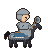 | [重骑晋阶 · Axe](class-previews/G056.gif) [S30 署名](CLASS-CREDITS.md#S30) | [剑](class-previews/G055.gif)、[枪](previews/C06.gif)、[斧](class-previews/G056.gif) | **轮廓相近**。重装骑马基本轮廓直接匹配；黑马厚铁铠、灰铁巨肩甲、包住后脑面颊的重盔，去除金色装饰。 同组：铁甲骑兵、奥利哈铁骑、烈骏神将。 |
| **烈骏神将** `divine_cavalier` |  | [重骑晋阶 · Lance](previews/C06.gif) [S30 署名](CLASS-CREDITS.md#S30) | [枪](previews/C06.gif)、[剑](class-previews/G055.gif)、[斧](class-previews/G056.gif) | **局部改绘**。同高级重骑底稿，马改赤焰毛色并补火焰鬃尾；骑手金白辉甲、白翼头盔及阵营长披风。火焰逐帧绘制，不是单纯换色完成。 同组：铁甲骑兵、奥利哈铁骑、英勇骑士。 |

## 魔法（8）

| 当前职业 | 当前像素图 | 对应 GIF／资源家族 | 武器动作 | 改绘与共用方案 |
|---|---|---|---|---|
| **诅咒师** `adept` |  | [兜帽咒术 · Magic (Fixed)](class-previews/G060.gif) [S33 署名](CLASS-CREDITS.md#S33) | [剑](class-previews/G063.gif)、[斧](class-previews/4fc66adaa4b7f49a.gif)、[拳](class-previews/6445510a1864e2e0.gif)、[魔法](class-previews/G060.gif)、[杖](class-previews/G061.gif) | **局部改绘**。攻击动作已按实际武器补齐；同组职业复用动作。当前保留各来源人物的装束并适配阵营色，尚未把不同武器包统一重绘为同一套服装。拳击采用 Enchanter 的真实攻击段，非徒手待机。 |
| **萨满巫师** `mage` |  | [仪式法袍 · Magic](class-previews/G062.gif) [S34 署名](CLASS-CREDITS.md#S34) | [剑](class-previews/G063.gif)、[拳](class-previews/6445510a1864e2e0.gif)、[魔法](class-previews/G062.gif)、[杖](class-previews/G064.gif) | **较大重绘**。攻击动作已按实际武器补齐；同组职业复用动作。当前保留各来源人物的装束并适配阵营色，尚未把不同武器包统一重绘为同一套服装。拳击采用 Enchanter 的真实攻击段，非徒手待机。 同组：德鲁伊。 |
| **先知** `sage` | 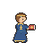 | [贤者法袍 · Magic (Fixed) {Shin19}](class-previews/G065.gif) [S35 署名](CLASS-CREDITS.md#S35) | [剑](class-previews/G066.gif)、[拳](class-previews/6445510a1864e2e0.gif)、[魔法](class-previews/G065.gif)、[杖](class-previews/G067.gif) | **局部改绘**。攻击动作已按实际武器补齐；同组职业复用动作。当前保留各来源人物的装束并适配阵营色，尚未把不同武器包统一重绘为同一套服装。拳击采用 Enchanter 的真实攻击段，非徒手待机。 同组：锻造师。 |
| **锻造师** `blacksmith` |  | [贤者法袍 · Axe](class-previews/G068.gif) [S35 署名](CLASS-CREDITS.md#S35) | [斧](class-previews/G068.gif)、[魔法](class-previews/G069.gif) | **较大重绘**。复用斧与施法时序；长袍整体重绘为卷袖衬衫、厚皮围裙、护目镜、手套及腰间锤钳，不能直接视作铁匠。 同组：先知。 |
| **高阶墓志铭** `high_epitaph` |  | [暗黑魔骑 · Magic](class-previews/G070.gif) [S36 署名](CLASS-CREDITS.md#S36) | [剑](class-previews/G071.gif)、[魔法](class-previews/G070.gif) | **较大重绘**。保留马背剑与魔法；重绘灰紫幽灵马、青光眼与烟状鬃尾，骑手改黑兜帽袍及骷髅扣。 同组：黑暗骑士。 |
| **德鲁伊** `druid` |  | [仪式法袍 · Magic](class-previews/G062.gif) [S34 署名](CLASS-CREDITS.md#S34) | [剑](class-previews/G063.gif)、[拳](class-previews/6445510a1864e2e0.gif)、[魔法](class-previews/G062.gif) | **较大重绘**。攻击动作已按实际武器补齐；同组职业复用动作。当前保留各来源人物的装束并适配阵营色，尚未把不同武器包统一重绘为同一套服装。拳击采用 Enchanter 的真实攻击段，非徒手待机。 同组：萨满巫师。 |
| **神军师** `mage_knight` |  | [步行军师 · Magic](class-previews/G072.gif) [S37 署名](CLASS-CREDITS.md#S37) | [剑](class-previews/G073.gif)、[魔法](class-previews/G072.gif) | **较大重绘**。采用步行 Mark 的 Sword 与 Magic；重绘黑高冠、白底蓝边宽袖袍和轻肩甲；保持步行，禁止换骑马 Mage Knight。 |
| **黑暗骑士** `dark_knight` | 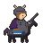 | [暗黑魔骑 · Sword](class-previews/G071.gif) [S36 署名](CLASS-CREDITS.md#S36) | [剑](class-previews/G071.gif)、[魔法](class-previews/G070.gif) | **局部改绘**。保留黑暗骑士马背剑与魔法；统一黑马、乌黑尖刺甲、弯角盔和紫披风。 同组：高阶墓志铭。 |

## 斧战（4）

| 当前职业 | 当前像素图 | 对应 GIF／资源家族 | 武器动作 | 改绘与共用方案 |
|---|---|---|---|---|
| **土匪** `fighter` | 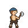 | [角斗士与土匪 · Axe](previews/A02.gif) [S10 署名](CLASS-CREDITS.md#S10) | [剑](class-previews/G018.gif)、[斧](previews/A02.gif)、[拳](class-previews/42297d62f7944a67.gif) | **局部改绘**。攻击动作已按实际武器补齐；同组职业复用动作。当前保留各来源人物的装束并适配阵营色，尚未把不同武器包统一重绘为同一套服装。拳击采用 Strong Guy 的真实攻击段，非徒手待机。 同组：斗士。 |
| **战斗将领** `battlemaster` | 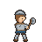 | [披甲斧将 · Axe](class-previews/G019.gif) [S11 署名](CLASS-CREDITS.md#S11) | [剑](class-previews/G020.gif)、[斧](class-previews/G019.gif)、[拳](class-previews/42297d62f7944a67.gif) | **局部改绘**。攻击动作已按实际武器补齐；同组职业复用动作。当前保留各来源人物的装束并适配阵营色，尚未把不同武器包统一重绘为同一套服装。拳击采用 Strong Guy 的真实攻击段，非徒手待机。 同组：永霸神将。 |
| **永霸神将** `everlord` | 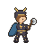 | [披甲斧将 · Axe](class-previews/G019.gif) [S11 署名](CLASS-CREDITS.md#S11) | [剑](class-previews/G020.gif)、[斧](class-previews/G019.gif)、[拳](class-previews/42297d62f7944a67.gif) | **局部改绘**。攻击动作已按实际武器补齐；同组职业复用动作。当前保留各来源人物的装束并适配阵营色，尚未把不同武器包统一重绘为同一套服装。拳击采用 Strong Guy 的真实攻击段，非徒手待机。 同组：战斗将领。 |
| **狂战士** `berserker` | 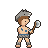 | [狂战士 · Axe](class-previews/G021.gif) [S12 署名](CLASS-CREDITS.md#S12) | [斧](class-previews/G021.gif) | **局部改绘**。裸身重斧动作可用；按现有造型补灰狼皮兜帽、蓝战纹、毛皮短裙与裹毛赤足。狼皮轮廓需要逐帧跟随。 |

## 格斗（3）

| 当前职业 | 当前像素图 | 对应 GIF／资源家族 | 武器动作 | 改绘与共用方案 |
|---|---|---|---|---|
| **斗拳手** `brawler` |  | [拳杖格斗 · Melee](class-previews/G002.gif) [S45 署名](CLASS-CREDITS.md#S45) | [拳](class-previews/G002.gif) | **局部改绘**。采用真正 Boxer Melee 拳击；统一白背心、阵营色短裤、红头带尾、白缠手和拳击鞋。 同组：武僧、破拳神将。 |
| **武僧** `monk` |  | [拳杖格斗 · Melee](class-previews/G002.gif) [S45 署名](CLASS-CREDITS.md#S45) | [拳](class-previews/G002.gif)、[杖](class-previews/G088.gif) | **较大重绘**。沿斗拳手复用真实拳击和独立 Staff；逐帧改橙黄单肩袈裟、裸右肩、大念珠、灯笼裤、绑腿草鞋。War Monk 的 Unarmed 不能替代拳攻击。 同组：斗拳手、破拳神将。 |
| **破拳神将** `fist_deity` |  | [拳杖格斗 · Melee](class-previews/G002.gif) [S45 署名](CLASS-CREDITS.md#S45) | [拳](class-previews/G002.gif)、[杖](class-previews/G088.gif) | **较大重绘**。沿斗拳手武僧复用拳击及杖；逐帧重绘赤膊金项圈臂环、白长裤、长腰带尾及燃烧气焰光轮。 同组：斗拳手、武僧。 |

## 潜行（6）

| 当前职业 | 当前像素图 | 对应 GIF／资源家族 | 武器动作 | 改绘与共用方案 |
|---|---|---|---|---|
| **恶棍** `rogue` | 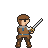 | [皮衣游侠 · Sword (stab)](class-previews/G022.gif) [S13 署名](CLASS-CREDITS.md#S13) | [剑](class-previews/G022.gif)、[弓](class-previews/G023.gif) | **局部改绘**。步行长衣剑／弓两套动作可作底；改毛领长皮衣、眼罩、单边尖肩甲，不按英文 Rogue 误套只会剑／杖的 FE8 盗贼。 同组：游侠。 |
| **游侠** `ranger` | 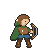 | [皮衣游侠 · Bow](class-previews/G023.gif) [S13 署名](CLASS-CREDITS.md#S13) | [剑](class-previews/G024.gif)、[弓](class-previews/G023.gif) | **局部改绘**。与恶棍共用步行剑／弓动作；改森林绿披风、垂落兜帽、箭袋和系带背心。当前游侠是步行，不能用骑马 Ranger 代替。 同组：恶棍。 |
| **探影者** `shadow_seeker` | 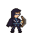 | [兜帽暗影 · Bow](class-previews/G025.gif) [S14 署名](CLASS-CREDITS.md#S14) | [剑](class-previews/G026.gif)、[弓](class-previews/G025.gif) | **局部改绘**。兜帽刺客剑／弓动作可共用；加破边暗紫斗篷、遮眼发光面具、斜挂短刀和紫边。保持步行身形。 同组：绝祸神将、刺客。 |
| **盗贼** `thief` | 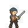 | [盗贼与忍者 · Sword](class-previews/G027.gif) [S15 署名](CLASS-CREDITS.md#S15) | [剑](class-previews/G027.gif) | **局部改绘**。轻装盗贼剑动作适合；改阵营头巾、颈后堆叠兜帽、皮背心、双腰包和缠腕。 同组：忍者。 |
| **刺客** `assassin` | 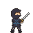 | [兜帽暗影 · Sword](class-previews/G026.gif) [S14 署名](CLASS-CREDITS.md#S14) | [剑](class-previews/G026.gif)、[弓](class-previews/G025.gif) | **局部改绘**。与探影者共用兜帽剑／弓动作；缩短斗篷，改炭黑紧身衣、面罩、交叉皮带和阵营腰条，保持刺客轮廓。 同组：探影者、绝祸神将。 |
| **忍者** `ninja` | 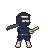 | [盗贼与忍者 · Knife](class-previews/G028.gif) [S16 署名](CLASS-CREDITS.md#S16) | [短刀](class-previews/G028.gif) | **局部改绘**。已有 Knife 对应短刀攻击，可用作当前 dagger；补钢护额、藏青忍装与长阵营围巾。若武器是手里剑，另检查／重绘投掷帧，不能只改小图标。 同组：盗贼。 |

## 飞行（4）

| 当前职业 | 当前像素图 | 对应 GIF／资源家族 | 武器动作 | 改绘与共用方案 |
|---|---|---|---|---|
| **天翼兵** `pegasus` | 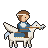 | [天马晋阶 · Lance (Fixed)](class-previews/G041.gif) [S24 署名](CLASS-CREDITS.md#S24) | [剑](class-previews/G042.gif)、[枪](class-previews/G041.gif) | **轮廓相近**。白色有翼马与轻甲骑手直接匹配基本轮廓；改银胸甲、阵营短衣、白发带并减去高阶装饰。选 Fixed 剑枪版本。 同组：圣天翼兵。 |
| **驭龙兵** `dragon_knight` | 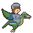 | [飞龙晋阶 · Lance](class-previews/G051.gif) [S29 署名](CLASS-CREDITS.md#S29) | [剑](class-previews/G052.gif)、[枪](class-previews/G051.gif)、[斧](class-previews/G053.gif) | **局部改绘**。保留有翼飞龙骑手与三武器；绿龙、铁黑尖肩甲、护颊盔及短披风，降低高阶装饰。 同组：飞龙将领。 |
| **圣天翼兵** `falcon` |  | [天马晋阶 · Lance (Fixed)](class-previews/G041.gif) [S24 署名](CLASS-CREDITS.md#S24) | [剑](class-previews/G042.gif)、[枪](class-previews/G041.gif) | **局部改绘**。共用天翼兵的 Fixed 剑枪骨架；加金饰马铠、更大白翼、银甲披风与长白羽盔；扩翼时补飞行与攻击遮挡。 同组：天翼兵。 |
| **飞龙将领** `dragon_commander` | 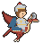 | [飞龙晋阶 · Axe](class-previews/G053.gif) [S29 署名](CLASS-CREDITS.md#S29) | [剑](class-previews/G052.gif)、[枪](class-previews/G051.gif)、[斧](class-previews/G053.gif) | **局部改绘**。共用驭龙兵底稿；赤鳞龙补颈甲额甲，骑手金边重甲、大披风及红冠缨，保持三武器一致。 同组：驭龙兵。 |

## 治疗（9）

| 当前职业 | 当前像素图 | 对应 GIF／资源家族 | 武器动作 | 改绘与共用方案 |
|---|---|---|---|---|
| **牧师** `cleric` |  | [圣职长袍 · Staff](class-previews/G074.gif) [S38 署名](CLASS-CREDITS.md#S38) | [斧](class-previews/9a0132981b309936.gif)、[拳](class-previews/6445510a1864e2e0.gif)、[魔法](class-previews/G075.gif)、[杖](class-previews/G074.gif) | **局部改绘**。攻击动作已按实际武器补齐；同组职业复用动作。当前保留各来源人物的装束并适配阵营色，尚未把不同武器包统一重绘为同一套服装。拳击采用 Enchanter 的真实攻击段，非徒手待机。 同组：主教、圣转神将。 |
| **主教** `bishop` |  | [圣职长袍 · Staff](class-previews/G076.gif) [S39 署名](CLASS-CREDITS.md#S39) | [斧](class-previews/G083.gif)、[拳](class-previews/6445510a1864e2e0.gif)、[魔法](class-previews/G077.gif)、[杖](class-previews/G076.gif) | **局部改绘**。攻击动作已按实际武器补齐；同组职业复用动作。当前保留各来源人物的装束并适配阵营色，尚未把不同武器包统一重绘为同一套服装。拳击采用 Enchanter 的真实攻击段，非徒手待机。 同组：牧师、圣转神将。 |
| **游唱诗人** `troubadour` |  | [骑乘圣职 · Staff](class-previews/G078.gif) [S40 署名](CLASS-CREDITS.md#S40) | [魔法](class-previews/G079.gif)、[杖](class-previews/G078.gif) | **局部改绘**。保留骑乘杖与魔法；改浅色金鬃马、白衫束腰、玫瑰羽贝雷帽和奶白短披风。 同组：瓦尔基里姆。 |
| **卫士** `guardian` |  | [圣枪步兵 · Lance](class-previews/G080.gif) [S41 署名](CLASS-CREDITS.md#S41) | [枪](class-previews/G080.gif)、[杖](class-previews/G081.gif) | **局部改绘**。保留步行枪／杖两种动作，改银板甲、十字罩袍和白羽敞面盔。 同组：圣枪师、岚枪神将。 |
| **圣枪师** `sentinel` |  | [圣枪步兵 · Lance](class-previews/G080.gif) [S41 署名](CLASS-CREDITS.md#S41) | [枪](class-previews/G080.gif)、[杖](class-previews/G081.gif) | **局部改绘**。与卫士共用步行枪／杖动作，升级锁子甲、白长罩衣、双翼高盔和斜肩圣带。 同组：卫士、岚枪神将。 |
| **贤士** `wiseman` |  | [行脚圣职 · Staff](class-previews/G082.gif) [S42 署名](CLASS-CREDITS.md#S42) | [斧](class-previews/G083.gif)、[拳](class-previews/6445510a1864e2e0.gif)、[杖](class-previews/G082.gif) | **较大重绘**。攻击动作已按实际武器补齐；同组职业复用动作。当前保留各来源人物的装束并适配阵营色，尚未把不同武器包统一重绘为同一套服装。拳击采用 Enchanter 的真实攻击段，非徒手待机。 |
| **瓦尔基里姆** `valkyrie` |  | [骑乘圣职 · Staff](class-previews/G084.gif) [S43 署名](CLASS-CREDITS.md#S43) | [魔法](class-previews/G085.gif)、[杖](class-previews/G084.gif) | **较大重绘**。复用骑乘魔法与杖；改白马、银胸甲、短裙甲、翼盔与阵营色长披风；素材马的金翼需要移除。 同组：游唱诗人。 |
| **岚枪神将** `storm_lancer` |  | [圣枪步兵 · Lance](class-previews/G080.gif) [S41 署名](CLASS-CREDITS.md#S41) | [枪](class-previews/G080.gif)、[杖](class-previews/G081.gif) | **局部改绘**。与卫士、圣枪师共用枪／杖动作，改蓝白雷纹铠、高翼冠盔及闪电边披风；电光需要另画。 同组：卫士、圣枪师。 |
| **圣转神将** `saint` |  | [圣职长袍 · Staff](class-previews/G086.gif) [S44 署名](CLASS-CREDITS.md#S44) | [斧](class-previews/G083.gif)、[弓](class-previews/004643696930ec84.gif)、[魔法](class-previews/G087.gif)、[杖](class-previews/G086.gif) | **较大重绘**。攻击动作已按实际武器补齐；同组职业复用动作。当前保留各来源人物的装束并适配阵营色，尚未把不同武器包统一重绘为同一套服装。 同组：牧师、主教。 |

## 兽人（5）

| 当前职业 | 当前像素图 | 对应 GIF／资源家族 | 武器动作 | 改绘与共用方案 |
|---|---|---|---|---|
| **幼战士** `beast_cub` | 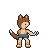 | [人形兽爪 · Melee](class-previews/G089.gif) [S46 署名](CLASS-CREDITS.md#S46) | [兽爪](class-previews/G089.gif) | **较大重绘**。缩小身体比例，重绘大兽耳、毛边背心、阵营色短裤、赤足毛脚环。保留人形双足爪击，调整现有兽耳、兽尾；不采用变狼或四足怪物。现成底稿已有兽耳兽爪；仍需按本职业体态调整身形、服装和尾部，不能只改颜色。 同组：兽战士、兽勇士、兽王卫、兽神将。 |
| **兽战士** `beast_fighter` |  | [人形兽爪 · Melee](class-previews/G089.gif) [S46 署名](CLASS-CREDITS.md#S46) | [兽爪](class-previews/G089.gif) | **较大重绘**。改赤膊、斜披兽皮、阵营色腰布、护腕与腿毛。保留人形双足爪击，调整现有兽耳、兽尾；不采用变狼或四足怪物。现成底稿已有兽耳兽爪；仍需按本职业体态调整身形、服装和尾部，不能只改颜色。 同组：幼战士、兽勇士、兽王卫、兽神将。 |
| **兽勇士** `beast_hero` |  | [人形兽爪 · Melee](class-previews/G090.gif) [S47 署名](CLASS-CREDITS.md#S47) | [兽爪](class-previews/G090.gif) | **较大重绘**。改兽牙项链、缝布皮胸甲、红色面纹及半截兽皮披风。保留人形双足爪击，调整现有兽耳、兽尾；不采用变狼或四足怪物。现成底稿已有兽耳兽爪；仍需按本职业体态调整身形、服装和尾部，不能只改颜色。 同组：幼战士、兽战士、兽王卫、兽神将。 |
| **兽王卫** `beast_guard` | 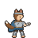 | [人形兽爪 · Melee](class-previews/G090.gif) [S47 署名](CLASS-CREDITS.md#S47) | [兽爪](class-previews/G090.gif) | **较大重绘**。加钢胸甲、毛皮翻领、露耳铁额甲、兽皮披风与铁护胫。保留人形双足爪击，调整现有兽耳、兽尾；不采用变狼或四足怪物。现成底稿已有兽耳兽爪；仍需按本职业体态调整身形、服装和尾部，不能只改颜色。 同组：幼战士、兽战士、兽勇士、兽神将。 |
| **兽神将** `beast_lord` | 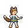 | [人形兽爪 · Melee](class-previews/G090.gif) [S47 署名](CLASS-CREDITS.md#S47) | [兽爪](class-previews/G090.gif) | **较大重绘**。加白鬃披肩、金额环、金纹长衣与发光金色臂纹。保留人形双足爪击，调整现有兽耳、兽尾；不采用变狼或四足怪物。现成底稿已有兽耳兽爪；仍需按本职业体态调整身形、服装和尾部，不能只改颜色。 同组：幼战士、兽战士、兽勇士、兽王卫。 |

## 龙人（5）

| 当前职业 | 当前像素图 | 对应 GIF／资源家族 | 武器动作 | 改绘与共用方案 |
|---|---|---|---|---|
| **觉醒者** `awakened` |  | [龙形五阶 · Dragonstone](class-previews/eaf39530057f4106.gif) [S48 署名](CLASS-CREDITS.md#S48) | [龙石](class-previews/eaf39530057f4106.gif) | **局部改绘**。以法的幼龙攻击作低阶底稿；保留小体型和吐息节奏，统一阵营标记与龙鳞配色。交战采用龙形，左侧小图仍是当前游戏的人形形象。 同组：龙人、古龙卫、龙贤者、龙神将。 |
| **龙人** `dragonkin` | 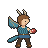 | [龙形五阶 · Dragonstone](class-previews/G094.gif) [S49 署名](CLASS-CREDITS.md#S49) | [龙石](class-previews/G094.gif) | **局部改绘**。以梅尔的有翼龙形攻击作二阶底稿；突出龙角、展开双翼和长尾，沿用真实龙息动作。交战采用龙形，不需要人形持石施法。 同组：觉醒者、古龙卫、龙贤者、龙神将。 |
| **古龙卫** `ancient_guard` | 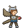 | [龙形五阶 · Dragonstone](class-previews/87341468bf8ad194.gif) [S50 署名](CLASS-CREDITS.md#S50) | [龙石](class-previews/87341468bf8ad194.gif) | **局部改绘**。采用 FE10 风格红龙攻击，改古铜鳞片、厚重角冠与防护鳞甲，作为重装龙形分支；沿用龙体和吐息动作。 同组：觉醒者、龙人、龙贤者、龙神将。 |
| **龙贤者** `dragon_sage` |  | [龙形五阶 · Dragonstone](class-previews/13bd38447a18962a.gif) [S51 署名](CLASS-CREDITS.md#S51) | [龙石](class-previews/13bd38447a18962a.gif) | **局部改绘**。采用魔龙的龙形攻击；改深蓝金纹龙鳞、角冠和魔力光效，作为施法龙形分支，不使用人形施法 GIF。 同组：觉醒者、龙人、古龙卫、龙神将。 |
| **龙神将** `dragon_lord` | 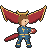 | [龙形五阶 · Dragonstone](class-previews/dcd62309e027b857.gif) [S52 署名](CLASS-CREDITS.md#S52) | [龙石](class-previews/dcd62309e027b857.gif) | **局部改绘**。采用 FE10 风格白龙攻击，白金龙鳞、金角冠及高阶龙息光效；与红龙保留相近的绘画风格，作为最终龙形。 同组：觉醒者、龙人、古龙卫、龙贤者。 |

## 先复用哪几组

- **人形兽爪（5）**：幼战士、兽战士、兽勇士、兽王卫、兽神将。
- **龙形五阶（5）**：觉醒者、龙人、古龙卫、龙贤者、龙神将。
- **重骑晋阶（4）**：铁甲骑兵、奥利哈铁骑、英勇骑士、烈骏神将。
- **飞鸵三阶（3）**：飞鸵兵、骑甲鸵兵、神鸵兵。
- **剑客与武士（3）**：剑客、侍道、刀剑将领。
- **拳杖格斗（3）**：斗拳手、武僧、破拳神将。
- **圣职长袍（3）**：牧师、主教、圣转神将。
- **圣枪步兵（3）**：卫士、圣枪师、岚枪神将。
- **兜帽暗影（3）**：探影者、绝祸神将、刺客。
- **村民与贵族（2）**：平民、贵族。
- **角斗士与土匪（2）**：斗士、土匪。
- **猎弓（2）**：猎兵、弓箭手。
- **皮衣游侠（2）**：恶棍、游侠。
- **骑兵晋阶（2）**：轻骑兵、荣光骑士。
- **天马晋阶（2）**：天翼兵、圣天翼兵。
- **仪式法袍（2）**：萨满巫师、德鲁伊。
- **骑射晋阶（2）**：森林骑士、弓骑士。
- **塔盾重甲（2）**：巨型重甲兵、要塞。
- **贤者法袍（2）**：先知、锻造师。
- **飞龙晋阶（2）**：驭龙兵、飞龙将领。
- **骑乘圣职（2）**：游唱诗人、瓦尔基里姆。
- **舞者与神乐（2）**：舞者、神乐神将。
- **暗黑魔骑（2）**：高阶墓志铭、黑暗骑士。
- **披甲斧将（2）**：战斗将领、永霸神将。
- **佣兵与勇者（2）**：佣兵、勇者。
- **盗贼与忍者（2）**：盗贼、忍者。
