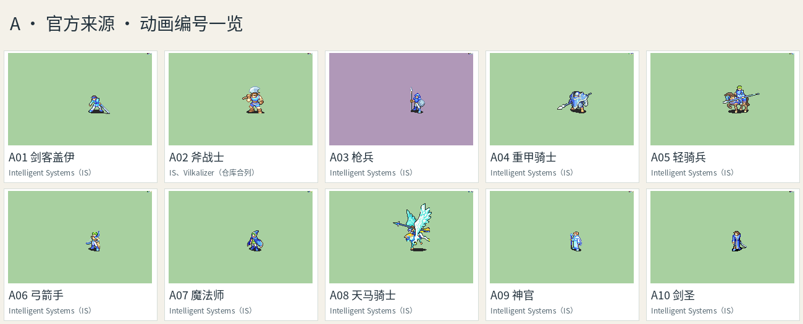
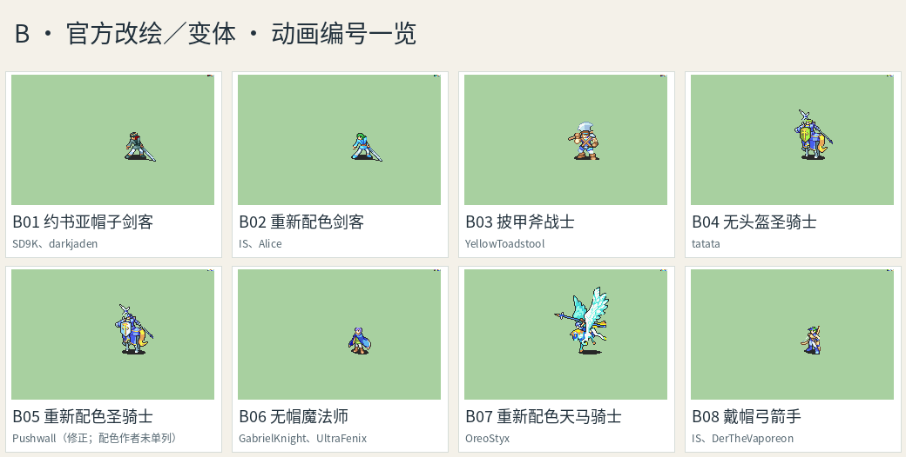
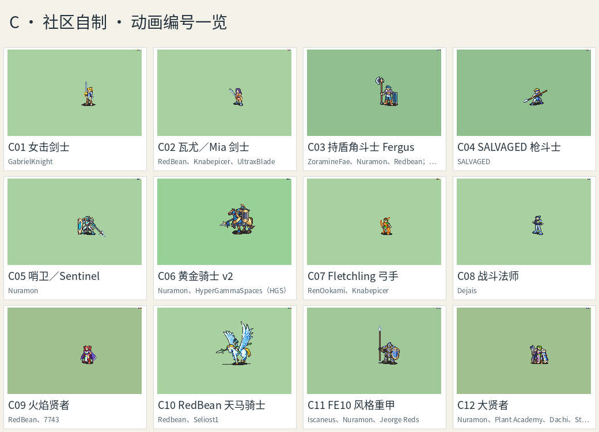

# FE-Repo 战斗动画候选

用浏览器打开 [index.html](index.html)：30 组本地预览，可按来源和职业筛选，点击播放／暂停，勾选后复制编号或下载所选署名。可直接双击打开，无需服务、构建或联网；前往原始资源链接时需要联网。选择不跨页面保存。

**全职业对照**：[classes.html](classes.html) 并排展示当前 77 个职业的游戏像素形象与对应 GIF，标注武器动作覆盖、共用家族和具体改绘方案；文字列表见 [CLASS-MAP.md](CLASS-MAP.md)，作者原文见 [CLASS-CREDITS.md](CLASS-CREDITS.md)。

**拳动画补充检索**：[9 个拳击／格斗版本与文件](fist/README.md)。原先缺少拳击的 13 个职业已分别接入 Boxer、Strong Guy、Enchanter 的真实攻击段，其他版本保留为参考。

- **A01–A10：官方来源**。当前选取的基础动作来自 IS／Vanilla 分类；个别仓库条目包含修正或联合署名，具体见卡片，不声称每张预览都未经修改。
- **B01–B08：官方改绘／变体**。换头饰、换装、重新配色或造型调整。
- **C01–C12：社区自制**。自定义动画；可能采用官方角色设计或其他作者部件，不等于完全原创 IP。

完整署名原文见 [CREDITS.md](CREDITS.md)。来源目录、明确选取的动作、原始 GIF、固定版本、校验值与许可依据见 [catalog.json](catalog.json)。`previews/*.gif` 原样保留仓库预览；同名 PNG 为第一帧暂停图。概览图仅供选外形，实际动作请播放 GIF。

当前 77 个职业的 162 个攻击武器组合已全部接入：155 个 FE 转换组合见 [../fe-anims/anims.json](../fe-anims/anims.json)，飞鸵新增的 7 个项目自绘组合见 [../battle-sheets](../battle-sheets/README.md)。外部素材完整署名在 [../fe-anims/CREDITS.md](../fe-anims/CREDITS.md) 及游戏「设置 · 美术鸣谢」。治疗杖只在地图演出。对照表仍保留不同来源装束的后续改绘建议。
