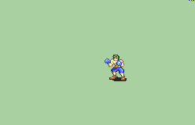
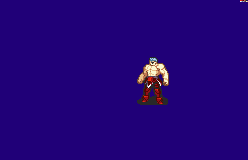
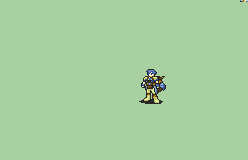

# 补充检索：拳击与格斗动画

找到 9 个可下载的动作版本，来自 5 类造型：Boxer、Strong Guy、Enchanter、Draconic Master 的 Punch，以及 Kicker。均已核对实际 GIF、FEBuilder 动画脚本和至少一张原始索引色 PNG；9 个 GIF 的帧数都与各自脚本总步数一致，普通攻击不是只有一张待机图。资源固定在 FE-Repo 版本 `222c1598f0a36ae5e6ade87030f6a8cc312febd8`。

这是拳击来源档案。原先的 13 项缺口现已补齐：平民、贵族接入 F01 Boxer，斗士／土匪／战斗将领／永霸神将接入 F03 Strong Guy，七个法系职业接入 F05 Enchanter。原有斗拳手、武僧、破拳神将继续使用 Boxer；其余候选保留作参考。各动作已适配阵营色，来源服装尚未全部按职业统一重绘。

## 文件与署名

| 编号 | 候选 | 动画预览 | 动画脚本 | 作者／贡献者 | 建议用途 |
|---|---|---|---|---|---|
| F01 | Boxer 拳击手 | [GIF](F01.gif) | [TXT](F01.txt) | Neph；目录的杖扩展为 Seliost1 | 通用轻装拳击；现有游戏已使用 |
| F02 | Boxer 光头版 | [GIF](F02.gif) | [TXT](F02.txt) | Neph、ShadowAllyX | 更换头发、头饰的底稿 |
| F03 | Strong Guy 壮汉 | [GIF](F03.gif) | [TXT](F03.txt) | TytheBub、ShadowAllyX | 斗士、土匪及披甲战士的格斗底稿 |
| F04 | Strong Guy 光头版 | [GIF](F04.gif) | [TXT](F04.txt) | TytheBub、ShadowAllyX | 壮汉去发型变体 |
| F05 | Enchanter 男附魔师 | [GIF](F05.gif) | [TXT](F05.txt) | Dora Drago（ドラドラゴ） | 法系、辅助职业格斗动作底稿 |
| F06 | Enchanter 女附魔师 | [GIF](F06.gif) | [TXT](F06.txt) | Dora Drago（ドラドラゴ） | 女性法系角色的对应版本 |
| F07 | Draconic Master · Punch | [GIF](F07.gif) | [TXT](F07.txt) | 目录标 Seliost1，但 Credits 只写 Magic，拳动作署名未明确 | 高阶职业备选；采用前补核署名 |
| F08 | Draconic Master · Punch 2 | [GIF](F08.gif) | [TXT](F08.txt) | 同上，拳动作署名未明确 | 普攻相同、必杀编排不同的备选 |
| F09 | Kicker 女踢击手 | [GIF](F09.gif) | [TXT](F09.txt) | Redbean 绘制、Seliost1 脚本 | 踢击／拳脚混合备选，不当作纯拳击 |

原目录完整署名见 [CREDITS.md](CREDITS.md)。固定版本的源目录、GIF、脚本、PNG 地址与 SHA-256 见 [sources.json](sources.json)。`Fxx-source.md` 原样保存源 README，`Fxx-frame.png` 是核验用的第一张原始帧，并非完整图集。

## 已补齐的 13 个职业

| 动作底稿 | 职业 | 数量 | 仍需调整 |
|---|---|---:|---|
| F01 Boxer | 平民、贵族 | 2 | 服装、帽饰与发型；不能只换颜色就算同一造型 |
| F03 Strong Guy | 斗士、土匪、战斗将领、永霸神将 | 4 | 体型匹配、护具、盔甲与披风 |
| F05 Enchanter 男版 | 诅咒师、萨满巫师、先知、牧师、主教、德鲁伊、贤士 | 7 | 各职业法袍、头饰、手部装备；男女版本按人物选择 |

这三组动作已实际共用，覆盖 13 个职业的拳攻击。当前保留来源造型；若要与各职业的剑、斧、法术形象完全一致，仍需逐帧调整服饰。

## 接入时要核对的细节

- 九个版本都有普通攻击、必杀、闪避和待机段，且普通／必杀均有多张不同姿势。
- Strong Guy 与 Kicker 用 `C0A` 标记必杀命中，Draconic Master Punch 用 `C09`；转换器已补齐 `C0A/C09/C0C` 命中识别和回归测试，普通／必杀各按对应帧扣血。
- Enchanter 的必杀含附魔准备与连续动作，原脚本也包含声音／特效指令；接入时要按实际演出长度检查节奏。
- 九个目录都标 F2U/F2E；使用时保留作者和借用部件贡献者。Draconic Master 的拳击署名信息不完整，暂列备选。

## 三个优先考虑的底稿

### Boxer

### Strong Guy

### Enchanter

