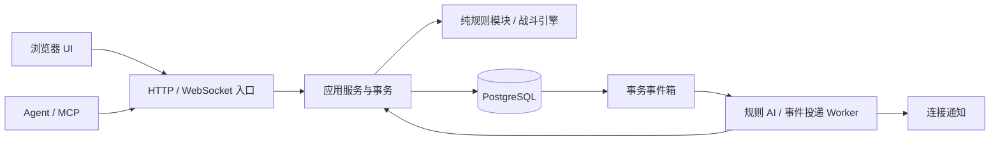

# 07 后端架构设计

> 更新：2026-10-16。本文替换全服赛季架构。玩法以 [00 玩法方案](00-game-design.md) 为准；领域状态与结算见 [12 后端领域设计](12-backend-domain-design.md)，接口见 [06 接口契约](06-agent-api.md)。这是待实现的设计；现有可运行部分仍是引擎 v1 和单机原型。

## 1. 系统边界

采用一个模块化后端和 PostgreSQL，不先拆微服务。浏览器与 Agent 使用相同应用服务，正式战斗只由服务端裁决。前端可以播放动画、显示缓存与预览，不能提交最终属性、金币、掉落或胜负。



- HTTP 用于会话建立、查询、目录与回放下载；`POST /api/v2/commands` 和 `WS /api/v2/ws` 承载同一命令信封，走同一处理器。
- 不存在全服推进个人日期的任务；离线、Worker 运行、现实午夜和榜单结算都不增加行动日。
- 同一玩家正式活动最多一项；有远征或年度赛事时，所有会改变被锁定角色／物品、推进日期的无关操作由服务端拒绝。
- 普通竞技场、练习、大竞技场共用战斗内核，风险和资源归属由规则模式明确指定，不能从 UI 路径推断。
- 技术栈沿用 TypeScript、Fastify、PostgreSQL。数据库驱动先采用 `pg`，原生参数化 SQL＋编号迁移；暂不引入 ORM、Redis、独立消息队列或外部调度服务。具体依赖版本在实现时锁定。

## 2. 模块与目录

以下是目标目录；当前不存在的目录不代表已有实现。

| 模块 | 位置 | 职责 |
| --- | --- | --- |
| 接入 | `backend/api/` | HTTP、WebSocket、认证、限流、JSON 校验、公开响应序列化 |
| 应用服务 | `backend/application/` | 命令处理、权限、事务、版本控制、调用领域规则、组装 DTO |
| 世界与日历 | `backend/domain/world/` | 日期推进、寿终、生产成熟、季度库存、年度赛事／故事可用性 |
| 军团 | `backend/domain/legion/` | 角色身份、成长、职业、技能、退役、传承、轮回 |
| 冒险 | `backend/domain/adventure/` | 自由路线、动态敌人等级、普通出征、连战副本状态迁移 |
| 赛事 | `backend/domain/arena/` | 年度海选与签表、普通竞技场、快照筛选、战绩与奖励 |
| 经济 | `backend/domain/economy/` | 钱包、物品实例、耐久、材料、招募、生产、精工挑战 |
| 任务与见闻 | `backend/domain/story/` | 八章可用性、见闻去重、任务进度、一次性奖励 |
| 纯规则 | `backend/common/` | 战斗、成长、等级预算、上限／药剂限制、地图、静态目录 |
| 类型契约 | `backend/common/protocol/v2.ts` | UI 与 Agent 共同导入的请求、DTO 与返回类型，尚非运行时验证器 |
| 持久化 | `backend/persistence/` | Repository、SQL、编号迁移、事务事件箱与幂等收据 |
| Worker | `backend/worker/` | 敌方阶段、背景签表模拟、推送投递、清理过期报价；不推进个人日历 |
| 校准 | `tools/sim/` | 路线对比、成长分布、九轮赛事和三图补给预算 |

领域规则不导入 HTTP、数据库或浏览器模块；API 不直接修改金币、角色或战斗 JSON。所有入口调用相同应用服务，避免 UI、Agent 和 Worker 各写一套规则。

## 3. 一条写命令的事务边界

1. 校验信封大小、协议版本、操作与数据结构，建立认证主体；不相信客户端传来的账号归属。
2. 开事务，按 `player_id` 锁定 `players` 行。所有改变个人世界的命令先取这把锁，再按固定顺序锁活动、战斗、单位、物品与钱包。
3. **先查幂等收据，再查预期版本。**同一 `(player_id, command_id)` 且操作与负载摘要一致，直接返回已保存响应；负载不同报 `IDEMPOTENCY_CONFLICT`。因此断线重试不会被自己上次成功增加的版本阻挡。
4. 检查 `expectedPlayerVersion`、必要的 `expectedBattleVersion`、所有权、活动锁、消耗和状态。失败不推进日期、不抽随机数、不扣资源。
5. 执行纯规则；将战斗状态、真实伤亡／消耗、奖励流水、日历变更、事件和幂等响应在**同一事务**写入。每次成功业务写入增加一次 `player_version`。
6. 提交后才能发通知。网络发送失败不能回滚已提交战斗，也不能再结算一次；客户端通过命令状态和事件游标恢复。

普通争用使用行锁加版本检查；唯一约束兜底重复报名、奖励和继承。默认事务隔离采用 Read Committed，加显式锁保护业务不变量。只有明确需要的跨玩家榜单更新使用额外的局部锁，不锁历史对手原账号。

数据库官方文档说明，`FOR UPDATE` 锁保持到事务结束；`SKIP LOCKED` 适合队列竞争消费，不适合作为普通业务读取的正确性保证。[PostgreSQL 行锁](https://www.postgresql.org/docs/18/explicit-locking.html)、[队列取锁语义](https://www.postgresql.org/docs/18/sql-select.html)

## 4. 战斗处理与崩溃恢复

保留 `step(state, action) -> { state, events }` 的纯函数边界，PRNG 不读取时钟、不调用 `Math.random`。`combat_rng`、`growth_rng`、`loot_rng`、`recruit_rng` 使用独立、服务端生成的随机流，活动创建时固定；查询预览不消耗随机序列。

- 玩家动作：验证版本，执行一步并原子保存新的战斗版本和持久角色／物品差额。
- `END_PHASE`：先保存敌方阶段与任务，返回 `processing: true`。Worker 从已保存状态执行确定性规则 AI，每次执行一个有序动作并独立提交。
- 一个战斗只能有一个正在执行的 AI 任务；任务以 `(battle_id, expected_version)` 识别。Worker 崩溃时，已提交动作保留，未提交动作从同一版本重算。租约过期可重领，旧租约不得覆盖新版本。
- 后端进程重启后可扫描 `phase=enemy` 的战斗补入缺失任务；浏览器离线时可完成已开始的敌方阶段，但不会自动提交玩家阶段操作或进入下一张地图。
- 亡者、护盾消耗、耐久和经验与对应战斗动作一同落库，不能等待整局胜负后才保存。客户端动画、旧快照和回放绝不写回正式状态。
- 撤离、投降、回合截止都是规则动作，必须走相同版本和幂等流程。已有伤亡不因失败而撤销。

公共 DTO 不含未结束对局的种子、PRNG、隐藏站位、防守优先级或未来掉落。存储类型与公开响应类型分离，HTTP 与 WebSocket 都按相同白名单输出。Fastify 的响应 schema 可限制输出字段；WebSocket 帧仍需应用层自行验证和序列化，不能假定 HTTP 路由校验自动覆盖它。[Fastify 验证与序列化](https://github.com/fastify/fastify/blob/main/docs/Reference/Validation-and-Serialization.md)

## 5. Worker、事件箱与后台任务

数据库中每次业务事务写入 `player_events` 和 `outbox`；Worker 使用带租约的队列消费，按账号事件游标通知连接，投递失败可重试。以 `event_id` 去重，交付语义为至少一次；业务结算依靠数据库约束和幂等收据保证只生效一次。

| 后台任务 | 可修改什么 | 禁止做什么 |
| --- | --- | --- |
| 规则 AI | 已开始战斗的敌方阶段 | 无授权开始下一场、替玩家消耗新行动日 |
| 签表模拟 | 当前玩家本届签表里的快照副本 | 修改历史对手的原单位、金币或日期 |
| 事件通知 | 推送已提交事件的游标 | 重新执行奖励或死亡 |
| 清理 | 现实时间到期的报价、精工租约及会话 | 因离线令作物生长、角色变老 |
| 可选榜单周期 | 统计竞技排名／封存榜单 | 重置军团或补发个人行动日 |

生产成熟、季度库存、年龄与年度故事按个人日历事务同步结算，不依赖后台准时运行。收获领取保持显式命令，成熟不等于已进入仓库。

## 6. 版本、回放与配置

每个活动固定 `ruleset_version`、`catalog_version`、地图生成版本、引擎版本和创建时的平衡参数；一次完整远征／年度赛事途中不切版本。新平衡只作用于新活动。旧回放不以当前数据表重新算数。

初期正式回放采用服务端已落库的公开事件序列与关键帧，按访问权限投影；相同版本的确定性重放用于校验。需要浏览器本地重演时再开放已结束战斗的独立战斗种子，永不公开账号成长／招募随机流。无法装载旧引擎时仍可观看存档关键帧，不自动用新规则给出不同结局。

配置随代码版本化，分为数值与规则开关：一年长度、各行动耗日、地区曲线、药剂额度、寿命区间、传承权重、海选轮数、各图恢复策略等。已确认规则不作为随意热更的实验开关：大竞技场会死、三角克制、传承二选一、连战固定名单与无自动恢复必须保持。

## 7. 认证、权限与运维边界

- 人类会话使用 HttpOnly、Secure、SameSite cookie；跨站写请求检查 Origin／CSRF。Agent 使用独立可撤销凭据，数据库只存凭据摘要，设置查询／普通养成／危险出征／退役传承等权限。凭据只在认证入口传递，不进命令样例或日志。
- 每次按资源所有者校验账号、战斗、单位、订单、物品、遗产与奖励；其他玩家快照仅可读其允许公开的投影。
- 对永久死亡出征和不可逆退役，UI 展示后端报价中的风险；Agent 需要玩家事先授予相应权限。授权不会因为重连重复索取，但业务状态变更后旧报价失效。
- `.env.local` 用于本地数据库等配置并已由 `.gitignore` 覆盖，文档只提供变量名；生产使用部署环境配置。日志保留命令编号、版本、耗时和错误码，过滤认证信息及未公开种子。
- `/health/live` 仅表示进程存活，`/health/ready` 检查数据库迁移和连接。数据库备份、恢复演练、命令失败率、AI 队列延迟、事件箱积压是第一期必需运维项。
- 管理修复只能追加有原因的审计／补偿记录，不手动重放已发奖励，也不默默复活死者。无玩家交易系统、聊天和邮件服务不在本期架构内。

## 8. 现有代码接入清单

| 现有实现 | 接入 v2 所需变化 |
| --- | --- |
| `engine/types.ts` 的 `field / arena` 两类 | 独立 `combat_kind`、`risk_policy`、`experience_policy`、`recovery_policy`，不能把所有 arena 都当无损 |
| 八项 `Stats`、E–S、固定 `CharacterId` | 加 `cha`、SS／SSS、实例 UUID、随机／固定／自捏角色模板，保持原引擎 v1 类型可回放 |
| `resolve.ts` 的 `alive=false` | 分出 `dead / withdrawn / defeated`；逐击祈祷→不朽盾→神撤退／普通角色死亡，连击立即检查保护 |
| 无武器实例／耐久 | 用 `item_id` 关联实例，逐击扣耐久，多段中途归零停止，普通竞技场使用副本 |
| 职业 Lv20、空级重掷、最大 HP 增长回血 | 99 级、个人固定上限、多次升级循环、独立继承补点；连战升级不回当前 HP；空级保护仅按版本配置 |
| `arena/rules.ts` 角色模板作身份 | 按实例／快照槽位禁用；三人早期 BAN=0；年度死亡跨轮保留 |
| `step.ts` 回合终结自动接入新阶段恢复 | 增加地图边界原因，连战转图不触发额外地形回血或异常递减 |
| 前端本地存储名册／竞技场 | 未来 UI 以 v2 DTO 和版本更新，正式账号不信任 localStorage 养成结果 |

不得宣称新增类型契约即已实现这些行为；上线前逐项通过第 12 文档的验收矩阵。

## 9. 实施顺序与检查

1. 迁移与事务基础、账号／会话、目录和 v2 schema、幂等／事件游标，先提供契约 mock。
2. 引擎 v2：九属性、死亡／盾／主角撤退、耐久与99级成长；保持现有 v1 回放可读。
3. 个人日历、名册／库存、独立出征与跨图副本；完成同一事务的伤亡同步。
4. 地区路线、成长／传承／退役／轮回、招募、探索和生产。
5. 普通竞技场与年度海选／64强签表、主线独立事件、历史快照匹配。
6. 精工小游戏原型、后期塔、数值模拟、持久化故障测试和部署。

当前仓库的可执行检查（PowerShell，在项目根目录）：

```powershell
tsc --strict --noEmit --target ES2022 --module ESNext --moduleResolution bundler --allowImportingTsExtensions backend/common/protocol/v2.ts backend/common/protocol/v2.examples.ts
$env:NODE_OPTIONS = '--experimental-strip-types'
node --test backend/common/engine/engine.test.ts backend/common/arena/arena.test.ts tools/mapgen/mapgen.test.ts
Remove-Item Env:NODE_OPTIONS
git diff --check
```

预期：类型契约无错误；现有32项原型测试通过；diff无空白错误。Node.js 22.18+可直接运行 `.ts`，22.14使用上面的兼容选项；这些检查不代表服务端集成测试已经存在。新增 API／数据库运行命令须在实现后随包脚本补充，不能提供当前无法启动的假命令。
