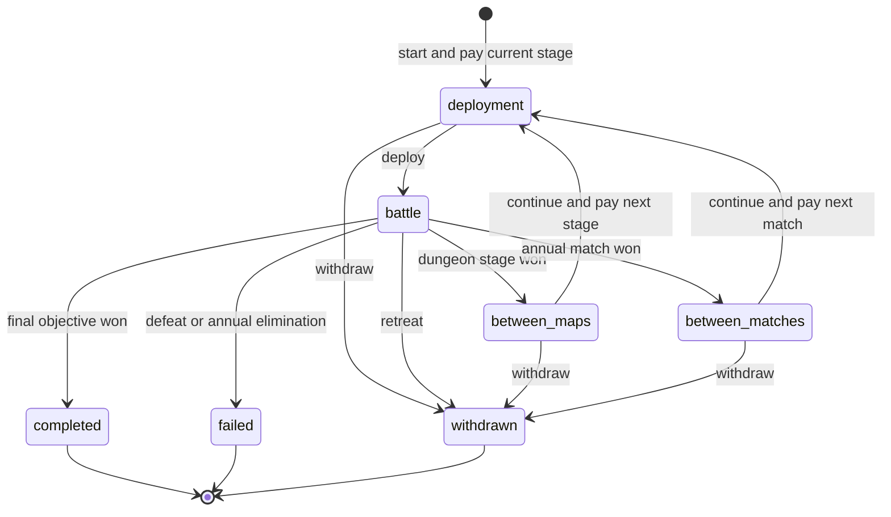

# 13 后端目标设计（含已实现部分与后续草案）

> 当前状态（2026-10-18）：命令收据、报价、轮回、传承、生产、派遣、年度赛制、事务／回滚、耐久、技能与首版内容均已有实现，精确范围见[TODO](../TODO.md)与[34](34-task-closure.md)。本文保留历史规范化表结构、候选接口和分轮记录，不是现行数据库字典；这些表名不自动成为必须重写的需求。可调用op以[生成协议](agent-api.md)为准。跨日历旧档迁移见[33](33-save-migration.md)，真实环境验收见[35](35-release-validation-record.md)。

> 2026-10-16职业修正：当前目录77项（原表采用58＋前作9＋兽／龙10），见[15](15-class-catalog.md)。删除勇士、上忍、机关师、战斗修士、战象兵，勇士旧编号合并至勇者。兽人与龙人只能沿本族下一阶进阶，不可跳阶、降阶、互转或转成人类职业；购买、切换、PROMOTE及派遣训练共用校验，轮回回到本族第一阶。人类跨普通路线规则保留。下文旧轮目标不覆盖本轮规则，不把目录数据等同于完整技能／魔法／特殊兵种机制。

> 成长采用原表弱项定向加强：现行58项中20项仅加名单属性、38项保留原值，19项扩展保留独立适配配置。勇者不叠加勇士成长。原始60行参考独立留档；九属性理由和12条八年培养试算见[16](16-class-growth-balance.md)。不重算已有永久属性；固定样本不代表完整经济、全技能或全部后期路线已平衡。

> 魅力遗漏已补入九属性数据、成长、上限、传承与轮回分配，见[17](17-class-growth-review.md)。旧存档只补缺失字段，不重算旧八项；旧99上限继承合同在读档或下次保底结算时按保存的`sourceTotal`刷新上限与目标；旧战斗保留原升级随机序列。示例角色初始魅力5／个人成长20%为首稿；魅力的计略／骑士团用途及官方系数仍待核对接入。

> 历史来源（2026-10-16）：合并远端`b7d2b8f`后保留的目标设计。当前采用Fastify、SQLite与数字op，版本、commandId、报价和业务／收据原子事务已有实现；规范化表结构与未列入生成协议的候选不自动接入。原型分支已通过`dca536b`纳入主线历史，处置见[32](32-branch-integration.md)。

## 2026-10-17 目标规则追加

以[00 最新确认](00-game-design.md)、[22](22-equipment-catalog.md)、[23](23-skill-catalog.md)为准；下列是当时追加的目标，首版落地与现行边界见TODO。

- 日期已采用`yearLength=500`、`quarterLength=125`、八年主线4000日；赛程计入4000日，不自动追加18日。120日旧档与未标记500日旧档使用[33](33-save-migration.md)显式工具；同日快照、年龄／寿命、季度库存、年度章节和派遣共用日历版本，不能只改显示常量。
- 地图保存`maxDeployed`和`enemyLevelCap`，部署不受全局16人常量限制；名册按主力＋约10替补设计。敌军生成后冻结且不突破本图上限，个人等级不反推提高上限，不加入年度经验硬额度。
- 玩家保存账号级`inheritanceUnlocked`与唯一解锁任务记录，领取遗产同时检查功能解锁和原资格，不给每名角色重复发解锁任务。
- 不朽盾每人1枚、限量来源、石化禁止全部HP回复；物理战技耐久、每本法术书次数、杖次数独立建模。书次数由旅馆／食物恢复，食物、费用、目标书和恢复结果同事务提交。
- 只保留玩家进攻、实例BAN与AI对手；旧防守设置和被挑战结算成为兼容数据，不再作为新功能要求。官方同日兜底；历史快照不回写原账号防守战绩或资产。
- 首版包含参考装备／技能、主动战技、完美＋10、酒馆两小游戏、最终首领、挑战塔和高难地区；所有玩家操作必须有Agent 1:1同规则入口。

下文旧规范化表和历史验收例中的防守计划、每击扣耐久、+5、固定日期／人数，仅在未被上述新定案替代时有效。

## 1. 不可破坏的约束

1. 账号有独立、单调增加的 `day`，起始0；无现实时间体力、追赶或赛季清空。
2. 一个账号最多一项未结束前台正式战斗／连战／赛事，可同时存在后台自动探索派遣与生产。并行以人员／物品互斥为边界，不能把前台单活动限制误用成全账号不可派遣；同一单位／物品不能同时归属两个活动。
3. 正式野外、地区副本和大竞技场的己方普通角色真实死亡；神主角撤退；普通竞技场与练习暂用模拟副本。历史对手的变化永远不回写原账号。
4. 一条战斗动作的状态、死亡／盾消耗／耐久、经验、事件与幂等收据同事务提交。
5. 地区副本固定名单、跨图不自动恢复；年度赛事可使用报名时替补，已死者不能跨轮恢复。
6. 成长与数值传承互斥且仅A→B一代；B不能再产可兑现遗产，轮回不清血缘锁。每份遗产只用一次，每人只接一次；数值保底逐级兑现，受逐项上限限制。
7. 年度比赛成绩不阻挡八章故事；赛事奖励与主线奖励使用不同唯一键。
8. 第一次讨伐只计不同地区，敌人不随玩家换装备、掉级或轮回自动缩放。
9. 随机候选、战斗、掉落、签表、成长只能由服务端创建并保存，查询／刷新不重掷。
10. 任何领取、生成、转移都有可追溯来源；金币／经验／材料不能负数，物品不能复制，已提交结果不能因请求超时撤销。

## 2. 数据模型与主键

主键使用服务端生成 UUID；目录ID是稳定字符串，不以名称作关联。数据库日期用非负 `bigint`，公开层限制为安全整数；事件游标是十进制字符串，不能在 JS 中转为浮点比较。真实时间使用 UTC `timestamptz`，仅用于会话、租约、报价与小游戏。

### 2.1 账号、配置与审计

| 表 | 核心字段 | 必需约束／索引 |
| --- | --- | --- |
| `accounts` | `id, display_name, status, created_at` | 显示名不当资源所有权凭证 |
| `sessions` | `id, account_id, credential_hash, expires_at, revoked_at` | 摘要唯一；按账号和到期时间索引 |
| `agent_credentials` | `id, account_id, credential_hash, scopes, revoked_at` | 摘要唯一；权限只由账号所有者赋予 |
| `players` | `id, account_id, setup_completed, day, version, active_run_id, ruleset_version, calendar_config` | `account_id UNIQUE`，`day>=0, version>=0`；初期每账号一个个人世界 |
| `rulesets` | `id, catalog_version, config_json, checksum` | 已使用版本不可原地修改 |
| `command_receipts` | `player_id, command_id, op, payload_hash, response_json, committed_at` | `PRIMARY KEY(player_id,command_id)`，摘要包含操作／数据／预期版本，不包含连接seq |
| `player_events` | `player_id, sequence, type, entity_id, player_version, payload_json` | `(player_id,sequence) UNIQUE`，仅追加；游标属于账号 |
| `outbox` | `id, player_id, sequence, topic, payload, lease_token, lease_until, delivered_at` | `(player_id,sequence,topic) UNIQUE`；未投递部分索引 |
| `audit_log` | `id, actor_id, action, subject_id, reason, receipt_id, created_at` | 写命令、管理补偿可追踪，敏感字段不进入payload |

### 2.2 军团、成长与继承

| 表 | 核心字段 | 必需约束／索引 |
| --- | --- | --- |
| `units` | `id, player_id, template_id, species_id, name, is_protagonist, status, class_id, level, exp, cycle, growth_type, age_base_days, age_epoch_day, lifespan_days, lifespan_end_day, lineage_depth, received_legacy_id, stats_json, caps_json, growth_json, hp, locked_run_id` | `level BETWEEN 1 AND 99, cycle IN(0,1), lineage_depth IN(0,1)`；每玩家主角部分唯一；死亡／退役不物理删除 |
| `unit_skills` | `unit_id, cycle, skill_id, rank, learned_source, equipped_slot` | `(unit_id,cycle,skill_id) UNIQUE`；习得装备技能槽只允许1–5，轮回清当前学习成果 |
| `skill_grants` | `unit_id, cycle, skill_id, source_kind, source_id, rank, active` | 按个人、职业、特殊装备分别归因；装备授予不占5格，离开来源即撤销，不当成永久学会 |
| `unit_class_qualifications` | `unit_id, cycle, class_id, purchased_at_day, receipt_id` | 每轮每职业唯一；年份开放后付金币获得，允许跨路线；轮回不复制旧资格 |
| `class_learning_progress` | `unit_id, cycle, class_id, mastery, unlocked_nodes_json` | 按该职业有效参战／训练积累，不用人物等级解锁全部；节点唯一，轮回清除 |
| `mastery_ledger` | `unit_id, cycle, source_kind, source_id, class_id, weapon_type, amount` | 同一有效战斗／派遣来源唯一入账，职业精通与现有武器熟练度分别记，不另建重复武器等级 |
| `class_market_periods` | `player_id, period_index, purchased, rules_version` | 月度额度限制购买新资格，切回已购职业免费且不占额度；月长／次数／累积仍待定 |
| `unit_proficiencies` | `unit_id, weapon_type, exp, rank` | `(unit_id,weapon_type) UNIQUE`；保存所有职业资格外的实际熟练度 |
| `growth_history` | `unit_id, cycle, level, rates_json, random_gains_json, inherited_gains_json, stats_after_json, rng_checkpoint_ref` | `(unit_id,cycle,level) UNIQUE`，首次一级基准另存；历史不可修改 |
| `unit_drug_usage` | `unit_id, cycle, stat_key, count` | `(unit_id,cycle,stat_key) UNIQUE`；总额由锁住角色后计算，不能只检查单项 |
| `legacies` | `id, player_id, source_unit_id, source_lineage_depth, cause, source_level, source_stats_json, source_growth_json, growth_components_json, state, recipient_unit_id, mode` | `source_unit_id UNIQUE`、`recipient_unit_id UNIQUE WHERE NOT NULL`；来源只能depth=0，冻结装备／被动来源；available→claimed |
| `inheritance_contracts` | `legacy_id, recipient_unit_id, target_level, initial_total, source_total, clipped_target, caps_json, weights_json, cycle` | `legacy_id UNIQUE, recipient_unit_id UNIQUE`；固定预览中确认的权重；旧99上限合同按保存source_total刷新上限与目标；轮回不重发 |
| `reincarnations` | `unit_id, source_cycle, target_cycle, base_stats_json, growth_allocation_json, new_age_base_days, receipt_id` | `unit_id UNIQUE`，仅0→1；清技能学习／熟练度／资格，年龄16岁及30点分配同事务，血缘锁保留 |
| `memorial_records` | `unit_id, cause, at_day, battle_id, final_snapshot_json, lineage_json` | 战死、寿终、退役均记录，原因区分；不能重复产遗产 |

年龄先按天计：`age_days = age_base_days + (player.day - age_epoch_day)`，整岁为`floor(age_days / year_length)`，余数用于生日。主角不随日期增加生理年龄，不能取得兽／龙资格。轮回时将普通角色`age_base_days=16*year_length`、`age_epoch_day=当前日`，按寿命规则重算寿终日，不能保留旧绝对日期使其立即寿终。寿命长度是否重抽未定，首稿建议保留长度。固定人物另用账号／模板资格记录阻止复制本人。

`growth_type`固定不变，只查询该类型的年龄曲线，不另叠一套年龄阶段修正。招募先锁类型，再从年龄>=12且尽量在剩余主线时间跨过该曲线一个转折的候选抽样；不要求两段时间相等，可只剩1年快速成长期。通常型等平稳曲线不伪造转折。每类曲线节点、权重、较晚招募和通关后兜底均需配置与校准，现有18–45岁常量不能直接当正式规则。

成长类型对玩家只显示label，不主动公开曲线、独立修正、转折时刻、抽取概率或年龄生成规则。内部记录仍完整，不能为了隐藏说明删掉结算依据；玩家可观察年龄、实际属性与成长历史，若界面显示合计成长则必须准确。浏览器／Agent面向玩家的说明都使用这一口径；调试资料不作为角色描述。当前v1 DTO仍有ageBand／growthBonus字段，不把移除一行页面说明宣称为完整协议字段隔离，也不承诺防止玩家自行推导。

### 2.3 物资、经济与生产

| 表 | 核心字段 | 必需约束／索引 |
| --- | --- | --- |
| `wallets` | `player_id, gold, bexp` | 主键player；两余额非负，与players同事务锁定 |
| `resource_balances` | `player_id, resource_id, quantity` | `(player_id,resource_id) PRIMARY KEY`，数量非负 |
| `item_instances` | `id, player_id, template_id, location, unit_id, run_id, durability, max_durability, durability_policy, weight, uses_remaining, quality, refinement_resolved, bound` | 单实例单location；耐久不超上限；无损耗策略仅候选配方启用，不能默认为全部完美成品 |
| `economy_ledger` | `id, player_id, receipt_id, source_key, asset, delta, balance_after` | `(player_id,source_key,asset) UNIQUE`，来源细化到item或resource；不修改历史流水 |
| `shop_stock` | `player_id, shop_id, quarter_index, offer_id, remaining, version` | `(player_id,shop_id,quarter_index,offer_id) UNIQUE`，库存非负 |
| `recruit_encounters` | `id, player_id, region_id, kind, created_day, candidate_json, state, cost_receipt_id` | 同一encounter接受／拒绝只能一次，拒绝后不可再付钱复原同一人 |
| `recruit_pity` | `player_id, region_id, failures` | `(player_id,region_id) UNIQUE`，付时间后按结果更新 |
| `recovery_recruit_claims` | `player_id, loss_episode_id, source_death_sequence, state, candidate_ids_json, claimed_unit_ids_json, receipt_id` | 真实伤亡且存活现役<=2（含神）时免费随机2人；每次新损失资格唯一，解雇／派遣不触发 |
| `facilities` | `id, player_id, template_id, tier, capacity` | 工位由归属与配置验证 |
| `production_orders` | `id, player_id, facility_id, recipe_id, state, started_day, ready_day, input_ledger_ref, output_spec_json` | 活跃工位不超容量；产出模板在开工时固定，领取不能重抽 |
| `refinement_challenges` | `id, order_id, state, rules_version, armed_at, started_at, expires_at, stop_received_at, result_json` | `order_id UNIQUE`；一订单一结果，过期结果固定normal |
| `reward_claims` | `player_id, source_kind, source_id, reward_key, receipt_id` | `(player_id,source_kind,source_id,reward_key) UNIQUE`；不同commandId也不能重复领奖 |

材料是数量余额，武器、药品、盾、传承石是可锁定实例；不把同名装备当成同一物品。死者装备先冻结遗产来源再解绑、保留当前耐久，已消耗物品不补发。已确认先转`recovery_bag`，单场／整次连战／整届赛事结束后再入仓库；活动途中不补给。它不属于战败没收的pending新掉落，不能复制两份或被错误没收。

酒馆补员已定：真实伤亡使存活现役总数<=2（含主角）时开放免费随机2人，不扣钱／日。派遣者仍计存活，解雇／退役不构成新伤亡；领取受活动锁限制。一次领取消耗当前损失资格，合并已发生但未领取的旧伤亡，不能囤多份旧资格反复领；以后有新真实伤亡且再次满足阈值才能再开放。候选固定，初始装备与强度仍待校准。

### 2.4 地区、远征与战斗

| 表 | 核心字段 | 必需约束／索引 |
| --- | --- | --- |
| `region_progress` | `player_id, region_id, first_clear_day, first_clear_level, unlocked_tiers, local_objectives` | `(player_id,region_id) PRIMARY KEY`；首次通关仅一次 |
| `map_progress` | `player_id, stage_id, first_clear_day, best_rating` | 与地区计数分开，单图获胜不算整区讨伐 |
| `runs` | `id, player_id, kind, state, registration_day, region_id, stage_index, stage_count, risk_policy, experience_policy, recovery_policy, level_spec_json, ruleset_version, catalog_version` | 未结束状态按player部分唯一；结束后不可恢复为active |
| `run_units` | `run_id, unit_id, initial_json, carried_json, disposition` | `(run_id,unit_id) UNIQUE`；角色的locked_run_id与之对应 |
| `run_items` | `run_id, item_id, initial_json, carried_json, ownership_policy` | 同一真实item最多一个未结束run，模拟副本不关联第二份真实资产 |
| `run_stages` | `id, run_id, stage_index, state, generated_map_ref, enemy_spec_json, day_cost, battle_id` | `(run_id,stage_index) UNIQUE`；全部地图／敌人种子入场时固定 |
| `run_loot` | `run_id, drop_id, spec_json, status` | `(run_id,drop_id) UNIQUE`，pending→released或forfeited |
| `battles` | `id, run_id, stage_id, version, phase, status, engine_version, initial_private_json, current_private_json, public_checkpoint_json, result_json` | 一个stage一个battle；版本单调增长；私有状态绝不直接作为响应 |
| `battle_actions` | `battle_id, action_index, source, command_id, input_json, result_hash, events_json` | `(battle_id,action_index) PRIMARY KEY`，玩家commandId唯一关联；含AI动作 |
| `jobs` | `id, kind, entity_id, expected_version, state, lease_token, lease_until, attempts` | `(kind,entity_id,expected_version) UNIQUE`，有限重试与失败告警 |
| `dispatches` | `id, player_id, state, region_id, started_day, duration_days, return_day, training_config_json, ruleset_version, reward_seed_ref, resolved_at_day, receipt_id` | duration为正整数，`return_day=started_day+duration_days`；个人行动日驱动，返程只结算一次 |
| `dispatch_units` | `dispatch_id, unit_id, cycle, class_id, weapon_type, departure_snapshot_json, result_json` | 锁出发时职业／武器／培养轮次，收益只给参与者，返程前不可参与其他战斗／派遣 |
| `unit_activity_locks` | `unit_id, owner_kind, owner_id` | 每单位唯一未释放占用；owner区分前台run与后台dispatch |
| `dispatch_rewards` | `dispatch_id, reward_key, type, spec_json, state, claimed_receipt_id` | 每来源／奖励键唯一；经验精通与物资分别明确结算时点，不因刷新／重复领取重发 |

`players.active_run_id`只表示前台活动。它与人员／物品占用的建立、释放同事务提交；后台派遣必须查实体锁，不能只查全账号active_run。已有前台活动时，可用未占用角色运行派遣；任何部署、训练、换职、轮回、退役、转移装备路径都要校验占用。跨账号引用验证归属，不能仅凭UUID存在就操作。

### 2.5 赛事、快照、故事与见闻

| 表 | 核心字段 | 必需约束／索引 |
| --- | --- | --- |
| `defense_plans` | `id, player_id, version, map_id, slots_json, behavior_json` | 可修改的当前方案，不等于历史快照 |
| `arena_snapshots` | `id, player_id, captured_day, kind, ruleset_version, catalog_version, qualification_json, private_roster_json, public_roster_json, defense_json, content_hash` | 生成后不可变；匹配索引 `(kind,captured_day,ruleset_version)` |
| `arena_entries` | `id, player_id, kind, annual_index, run_id, snapshot_id, state, qualifier_wins, qualifier_count, bracket_size` | 大竞技场 `(player_id,annual_index) UNIQUE WHERE kind=annual`；普通竞技场每次独立entry |
| `arena_matches` | `id, entry_id, phase, round, slot, snapshot_a, snapshot_b, state, result_json, battle_id` | `(entry_id,phase,round,slot) UNIQUE`；签表节点结果只写一次 |
| `rating_periods` | `id, mode, starts_at, ends_at, timezone, status, rewards_finalized_at` | 按现实月份，不与个人日历相连；归档后不可改旧榜，结算任务幂等 |
| `ratings` | `player_id, period_id, mode, progress_bracket, rating, wins, losses, matches` | 每玩家／月／模式／进度档唯一，新月从基准分开始，单场赛果只记一次 |
| `monthly_rating_rewards` | `period_id, player_id, final_rank, reward_spec_json, claimed_at, receipt_id` | `(period_id,player_id) UNIQUE`，冻结旧榜奖励，可跨月领取但不改新月分 |
| `story_events` | `player_id, chapter, available_day, state, completed_day` | `(player_id,chapter) UNIQUE`，章节1–8，不含名次门槛 |
| `quest_progress` | `player_id, quest_id, state, progress_json` | 与主线年度事件分开；不通过随机文献阻挡主线 |
| `discoveries` | `player_id, discovery_id, discovered_day, context_ref` | `(player_id,discovery_id) UNIQUE`，可回看文本按目录版本渲染 |

不创建现实赛季来驱动个人成长。已确认普通竞技场按现实月份归档并重置积分／名次／当月战绩，历史记录保留；不得清角色／资源、推进个人日期或发追赶资源。月界统一用服务端配置时区，不按每个浏览器时间判断。

## 3. 日历与动作报价

### 3.1 显示与边界

已确认`year_length=500, quarter_length=125`，八年共4000行动日。显示年份为`floor(D/500)+1`，季度为`floor((D%500)/125)+1`，年内日为`D%500+1`。年度届次与显示年份分开，由本年度赛程窗口确定；最长18日计入年度／主线预算，第八届最迟D3982开始才能在D4000结束。API返回日历版本与届次，UI不自行用旧120日推算；旧存档的年龄、派遣、生产和报名按版本迁移，不能把旧绝对日期直接套进新配置。

跨多日行动枚举`(old_day,new_day]`内所有边界，稳定按日期和事件优先级处理。建议同日顺序：寿终／资格变更→派遣返程／生产成熟→库存换季→年度赛事开放／故事事件。派遣与生产共用实际经过的日数，不因队数／工位数倍增时间。离线和零日读写不推进派遣；现实月榜结算是独立时钟，不推进个人日期。

### 3.2 报价与执行

`PREVIEW_ACTION` 返回与playerVersion绑定的 `quote_id`、实际耗日／金币／材料、开始结束日期、死亡风险、会遇到的日期事件和阻挡原因。报价生成可以保存短期报价行或签名数据，但不改变个人世界版本、不生成收益、不开战；不能把预测当成保底掉落。

`EXECUTE_ACTION` 锁玩家后重新验证报价、库存和活动状态，完整支付当前一步成本并推进日期；创建活动时记录推进前 `registration_day`，敌人按出发前已讨伐数量确定。若报价过期或版本变化，返回可刷新错误，不自动涨价后继续。

- 单场地图进入时支付本图全部日数，失败／退赛不退；三图远征不是入口一次收24日，后两图分别执行下一图报价。
- 年度报名先锁名单／快照并支付第一场两日，下一场再次明确支付两日；未打的轮次不收费。
- 所有活动参与者成长率使用本图出发时年龄。报价若发现出战者会在本图耗日区间自然寿终，阻止开图并提示先处理寿终／换人；不让寿终者以锁定快照继续参战。其他队员随日历正常寿终，完成纪念和遗产记录。
- 连战或赛事的下一场遇寿终时，先更新可用名单，允许撤离；副本不补人，赛事只能用原名单尚存活替补。不擅自把寿终改成战死。
- 一般等待一次最多一年，遇需要选择的剧情节点、寿终或赛事报名截止前可截停到最早节点；报价显示实际推进量。批量探索逐项提交／内部串行执行，不能一次跳过重要事件。
- 开始出征需要处理的游历候选等选择先解决；不会同时持有付过时间但未决招募与另一个正式远征。

### 3.3 招募、生产与库存

自捏开局锁住空players行，验证姓名、外观预设、九属性分配预算和两名初始伙伴资格；同事务生成唯一不死主角、两名伙伴与基础物资，再标记setup_completed。重复调用返回原幂等结果或已开局错误，不能重开免费刷初始属性。

游历推进四日后保存候选或失败，并更新地区保底；接受／拒绝不再扣日，拒绝不退四日。酒馆按当季库存直接支付金币、不推进日期；名册满时整个命令失败，不能先扣钱。固定人物领取额外检查招募资格唯一性。

生产开工先扣输入、消耗开工日，再设置 `ready_day=开工动作结束日+duration`。所有并行工位共享同一日期，绝不把并行等待相加。变为ready只代表可领取，仓库满时保留ready订单与输出；不丢东西，也不重复产出。

季度库存以个人quarter_index版本生成，打开商店不刷新；经过多个季度只保留当前库存，不把未购买库存累积送给玩家。领取生产与修理一般不额外推进日期，但受活动锁限制。

## 4. 活动与战斗状态机



同一个run只有一个当前stage。暂停仅断开连接／停止命令，不另建会恢复状态的“暂停副本”；任何状态查询都能恢复完整进度。`resolving`仅用于等待同一版本AI／结果任务，不能在该状态插入玩家操作。

### 4.1 真实资源投影

活动初始化复制战斗所需状态，但注明每项实体是 `owned_live` 还是 `simulated`。前者动作差额同步更新真实单位与物品，后者仅更新活动副本。副本中的HP与状态是当前活动的运行状态，真实角色记录同时保存其当前HP和死亡状态；禁止从报名初值整包覆盖真实单位。

普通模拟战结束可释放锁并丢弃模拟消耗；大竞技场或PvE绝不能复用该丢弃逻辑。对手被击败既不是当前玩家的遗产来源，也不导致对手原账号的角色死亡。

### 4.2 致死一击与不朽盾

当前目标：先校验并一次支付主动物理战技耐久／本书施法次数／杖次数，普通物理攻击不扣；逐击结算命中、技能、必杀、祈祷、盾与生命状态。每人最多1枚稀缺不朽盾，致命消耗后1HP石化到下个己方阶段，禁止任何HP回复。无法通过补给／交换补第二枚，重量另配。

石化解除用明确的 `expires_at_player_phase` 标记，不用“剩余1回合”猜测当前阶段。阶段开始的持续伤害先在保护仍有效时结算，再解除，保证1HP单位有操作机会。石化占格、不可行动／反击，治疗和光环按当前草案禁用。阶段结束、地图结束和异常清理不能让死者恢复active。

### 4.3 三图地区大副本

- 入口固定队员实例和物品；三张地图的生成种子、敌人等级与装备档同时锁定；只有一个远征可在进行中。
- `carry_state`逐项带入HP、异常剩余时长、技能次数／冷却、物品次数、耐久与已死名单。合法换出生位置不等于换人；不触发额外阶段、地形回血或计时递减。
- 升级提高最大HP时不增加当前HP；杖、药与合法技能按实际动作恢复。中途不允许仓库、酒馆、生产领取、修理、转职、轮回或替补。
- 首领图胜利时才释放远征袋、写地区first_clear、增加不同地区讨伐数。经验逐图保留；撤离／失败使pending掉落forfeited，死亡和消耗保留。普通单图胜利按其独立奖励结算。
- 下一图需要合法部署人数；不足则显示原因并可撤离，不恢复死者凑数。主角撤退结束副本的规则先采用草案配置。
- 保存重载恢复同一run，不允许重新开图覆盖不满意的成长或掉落。

### 4.4 自由路线与动态等级

`C`从 `region_progress.first_clear_day IS NOT NULL` 计数；普通单图通关不加C。新远征出发时保存 `C_at_start` 和地区偏移δ：

```text
B = min(93, 5 + 8 * C_at_start)
L = clamp(B + delta, 1, 95)
normal = clamp(L + encounter_offset, 1, 99)
elite = min(99, L + 2)
boss = min(99, L + 4)
```

查看地区不锁低级难度，只有实际创建run锁当次配置。通关后低难重打保留该地区首次等级档；玩家主动选择的高阶任务另存tier，不覆盖原图。十二地区全部可按合法道路到达，编号不是解锁顺序。材料档、职业许可和高级配方另按总进度控制，先到德拉克莫龙谷不直接给满级角色。

## 5. 成长、传承、轮回与死亡

### 5.1 成长与上限

九属性使用 `hp,str,mag,skl,spd,lck,def,res,cha`；运和幸运同一属性，体格／移动单列；HP上限150，其余八项无数值上限，已获属性与过去成长不重算；个人基础、职业、固定类型自身年龄曲线、装备、被动与其他临时修正分别保存；类型曲线只算一次。最终率最低0，每项基础增量`floor(rate/100)`，余数再掷一次，超上限裁剪。空级保护是否启用仍留配置，不假定旧重掷已被取消。

幸运和魅力按指定原作核对，不增加自创招募加成。技能来源分个人1个可升级、当前职业自带N能力、已学技能库和特殊装备授予。已学装备技能／被动可跨职业自由装备，共享5格，不以“被动”名义免费常驻；装备授予不占格，失去装备即失效。职业自带能力随当前职业重算，已学技能随换职保留；轮回清学习成果。节点改用职业精通，重复效果叠加仍需目录明确。

分配大量公共经验时逐级循环，依次记录自然成长与传承补点；1→99共98次，99级剩余经验固定0。随机流按角色实例与培养轮次固定，升级指令重试不得重掷。已离队／死亡角色不能接收公共经验。

### 5.2 遗产兑现

来源达标、lineage_depth=0且战死／寿终／退役后才生成一份available遗产。先冻结个人基础＋当时实际装备／有效被动提高的成长率及各来源，再回收装备；九属性总量另存。兑现事务：锁遗产、继承者、道具和钱包→验证一级新角色、未接遗产、depth=0及资格→计算预览目标→扣道具与资源→写claimed／合同→设置继承者depth=1与received_legacy_id。

- 成长模式替换基础向量，含来源当时装备／有效被动提供的成长；排除职业、年龄曲线、临时战斗状态和单列轮回奖励。只复制合成数值，不授予实际技能／装备；逐项来源仅用于审计，不作为光环再叠加一次。
- 职业数据自身成长向量与职业授予的成长被动分来源；后者若有效，按被动计入，不因其来自职业就漏掉，也不能同时在两项重复算。
- 数值模式总容量无上限（API `capacity: null`）、`target=sourceTotal`、`lost=0`、一级总量S0、来源等级Ld；每级下限 `F(l)=S0+ceil(max(0,target-S0)*(l-1)/(Ld-1))`。先自然成长，再补差额，不修改随机率。
- 采用正整数权重，对尚有容量的属性按“当前已分补点／权重最小者”逐点分配，相同则按固定StatKey顺序；权重全零拒绝。每次重新选择尚有容量项，绝不丢弃剩余补点；同一级可向同项补多点。
- `Ld=1`直接补到 `max(S0,target)`；`target<=S0`无需补。每级与当前轮次唯一记录阻止重复兑现；来源200时目标为200，HP达到150后余点转分配给其余八项。
- 一个来源一份遗产，一个接受者一种模式。仅A→B，B无论死亡、退役、寿终或轮回都不能再产可兑现遗产；两模式共用锁，不能先数值后成长延续到C。纪念仍保存但不可领取。

### 5.3 轮回与退役

轮回仅存活、未锁定、99级且cycle=0角色可用。一次事务扣资源、保存记录、清第一轮成长／药效／数值继承补点、恢复固定一级基准、cycle变1并开放新药剂额度。清已学技能、熟练度、职业资格和学习进度，回初始职业；个人技能回身份初始形态。年龄重置16岁并重算寿终日；身份、历史、血缘锁及已用轮回次数不清，额外仅30个百分点成长分配。已清资格不退金币／月度次数，账号世界年份及市场开放状态不倒退。

已确认轮回保留继承后的个人基础成长，不恢复继承前资质；额外30点轮回奖励单列、不跨代。数值旧合同结束、不重新补。职业精通与学习进度清除；特殊装备仅按实际穿戴重新授予，不算保留习得。退役不可参战，主角不可产遗产，普通解雇不自动成为合资格退役。

### 5.4 职业市场与跨路线

按个人年份开放职业，按角色／培养轮次付费取得资格；允许跨路线，神不可兽／龙。已购职业在营地免费切回、不占购买额度，战斗／派遣中不能切换。月度额度只限制新资格购买，周期长度／额度／累积仍待配置，不擅自把季度当月份。轮回清个人资格，不重置账号市场时期或退还额度；月度购买与现实竞技榜月份是两个独立周期。

### 5.5 职业精通与并行自动探索

职业精通以`(unit_id,cycle,class_id)`分别累计；有效参战或职业训练提供进度，人物等级不直接解锁该职业全部节点。战斗记来源battle，训练记来源dispatch，每个来源只入账一次；重复回合／投降不冒充有效参战。武器精通度复用现有武器经验与EDCBAS／SS／SSS，按出发时训练武器归因。每场／每日增益、节点和上限待配置，切回保留各职业进度，轮回清除。

派遣是后台占用任务，目标接口可增`GET_DISPATCHES`／`START_DISPATCH`；名称与op号需在真实协议接入时统一，此处不冒充已有接口。启动事务锁玩家、人员、装备，验证归属、现役／可用、资格、地点与正整数天数，冻结职业、武器、规则和收益种子，创建running任务并取得实体锁；不立刻推进整段日期，也不重复扣一份所选日数。

个人日历达到return_day时一次返程结算：按版本化规则计算参与者经验、职业精通、武器熟练度及素材／武器产出，保存报告和唯一收益键；人物培养逐级按经过日期处理，不能把最后一天的年龄套到全部多日成长。返程结算完成后释放人员／装备占用，物资可保存在待领取袋，未查看报告不让已返程者继续离队。具体自动发奖与物资领取UI可调整，但同一来源只能发一次。

派遣中禁止角色参加地区战斗、连续副本、年度／普通竞技场、第二项派遣，亦不可换职、轮回、退役、抽走装备。其余未占用角色正常活动；历史防守快照不占真人，已报名年度名单仍锁定。派遣不能额外锁整账号；若全员外出，仍可主动等待。普通模式不增加未告知随机永久死亡，寿终边界遵守个人日历规则。

例：D100派A十日，B／C完成一次八日战斗后为D108，A仍占用；再推进两日至D110即返程。现实离线十天不推进，零日买卖／查看不完成。两队各派十日共经过十日，不能累加成二十日；奖励只给各自参与者。提前召回、可同时派遣队数、最大时长和精确收益仍为配置／待定，不擅自允许零日或无限重复领取。

## 6. 年度大竞技场与普通竞技场

### 6.1 报名与快照

大竞技场以annual_index唯一报名，先预览真实死亡风险并锁报名日、名单、培养数值、带入物品与规则。对手只筛选同类型、同报名行动日和兼容规则版本的历史快照；正赛优先有资格记录的玩家，且一签表不重复同一原账号。精确同日不足时用官方队伍，明确source，绝不悄悄使用较晚日期快照。

快照只记录真实存在过的状态，不倒填过去；报名时固化公开名册与隐藏防守设置。每轮继续用同报名日池，当前玩家的死亡、消耗和耐久跨轮保存。对手原账号不需要在线，不承担该局伤亡；快照被挑战也不自动产可用金币。

### 6.2 海选与64强

已确认三场海选至少两胜，打完三场判断，未通过为eliminated；正赛64队单败，64→32→16→8→4→2→1。全签表63节点，玩家只打六轮；其他节点由规则AI模拟并保存，重试不换胜者。

每届均海选，年度entry退赛／淘汰不能重报。每轮可用存活报名替补，局间仅恢复存活者HP／短期状态，不恢复死者、消耗盾或耐久。已确认整届不额外买物资、不维修、不取外部仓库；缺员可继续，仍验证地图必要主将／目标。回收袋在整届结束释放，不借死者装备中途补给。

保存／断线不取消entry。赛程按最终日历版本验证剩余日数与寿终；玩家只进攻，BAN使用单位实例ID，候选不足必须用合法官方队伍补足或给出明确原因，不设置反向BAN／玩家防守结果。

### 6.3 主线独立结算

八章按个人日历开放，不检查胜率、海选资格、名次或地区通关数。参赛结束即可完成当届主线事件；未报名按玩法草案在本届窗口结束后开放观赛摘要。预留调节未参赛结算时间的配置，但不得改成夺冠前置。

`COMPLETE_STORY_EVENT`仅将该章completed；`CLAIM_REWARD`按唯一奖励键领取团队1350公共经验。竞赛金币／荣誉使用arena_entry单独奖励键，普通竞技场不领取章节经验。退赛金币默认0；主线章节不会因退赛而失效，也不会因领奖路径不同重复发。

### 6.4 普通竞技场

已确认随时报名、每场1日、独立报名和快照副本；金币、积分取有效胜负，等级经验0。非致死，药品／耐久模拟消耗不写真实资产，不能取得对手真实装备。开始对局只扣一次日数，重连不重复扣；奖励按1日成本重算金币效率。免费练习无经济收益。匹配精确同日，榜单可按较宽进度段统计；评分按match结果唯一结算，防守被多次挑战不自动发金币。

现实月榜已确认每月重置。Worker按服务时区归档旧period、冻结奖励，创建新月基准分；不修改个人行动日／角色／资源。目标默认以有效赛果提交时所属现实月份记分，跨月未完战斗可继续，完赛后只计新月一次，不回写已归档旧榜；月界具体时区及奖励档仍是配置。周期键、赛果唯一键和奖励领取键共同防止重复结算，旧月奖励可稍后领取但不重新增加新月分。

## 7. 完美锻造与其他小活动

正常生产与小游戏分离。订单ready后可普通领取，或先ARM一次精工挑战；ARM固定规则／奖励区与订单归属但不开始计时，START记录服务端真实开始时间，STOP记录服务端收到停止的时间并算位置。客户端不得提交“已完美”或任意时间戳作为结算依据。

网络延迟容错、Agent操作、前后端计时同步和输入体验仍需原型验证；首版 `features.refinement.enabled=false`，不能上线一个客户端随便报结果即可多发耐久的接口。启用后必须先通过双提交、超时、断线与延迟分布测试；时间校正上限由规则版本固定，不能由客户端扩大。

状态 `armed→running→resolved`；跳过或超时固定normal。首版精工成功最多一次最大耐久＋10，新品当前同步＋10；例如40／40→50／50。修理只恢复已有最大值，不再加上限；法术次数不套用物理精工。失败不毁正常成品。

无耐久损耗成品、指定材料＋完美结果的配方均为新增候选，默认不启用。若启用，开工先固定材料和durability_policy，再按唯一结果结算；不以极大耐久表示无损耗，不允许领取后追加材料反复重判。不能因为小游戏完美就默认所有武器无损耗。

小游戏的现实秒数不增加个人日历，且不存在脱离订单反复产材料的奖励入口。免费练习可以反复，但经济收益0。

### 7.1 酒馆小游戏（首版已实现，参数仍待人工平衡）

摇盅猜大小与四蛙赛跑的玩法、概率、返还和示例见[18](18-tavern-minigames-draft.md)。首稿20／50／100金币下注，个人游戏季度共6局，游戏间及地区间共享；不推进日历，免费练习无收益。人类／兽龙、幸运／魅力均不改变赔率。参数仍待审阅，不能据本文宣称游戏接口已上线。

后续准备独立的规则配置和小游戏收据：保存玩家、规则版本、游戏类型、个人季度键、下注选项、下注额、赛果、总返还和净收益。季度键由玩家行动日的year／season得到，不复用现实月榜periodIdFor。倍率按整数分数，先固定总返还是否含本金；猜大小三同点固定输，赛跑完整名次不得重复。

开始命令一次事务完成校验占用／金额／共享额度、扣款、计局、服务端随机、保存赛果和派奖；同一幂等标识重试只读原收据，客户端仅播放保存的结果。无需额外“动画完成”领奖入口，不信任客户端胜负、时间或名次。两端抢最后金币或额度时最多成功一局；失败不能半扣款。断线、退出、跳过和重播不重掷，也不重复派奖。具体协议及存储迁移留待实现时设计，当前不注册新op。

## 8. 故障、权限与验收矩阵

以下是将来实现的必须测试项，当前不冒充已有集成测试：

| 场景 | 预期结果 |
| --- | --- |
| 同一出征命令超时后重发 | 返回原receipt，日历、扣物与地图只发生一次 |
| 相同commandId换负载 | `IDEMPOTENCY_CONFLICT`，无新状态 |
| 两个连接同时消耗最后一个盾 | 玩家／物品锁和版本使最多一个有效命令提交 |
| 击杀落库后API断线 | 重连仍死亡，遗产最多一份，不回到初始快照 |
| Worker在敌人第3个动作后崩溃 | 从已保存版本续第4个动作，之前伤亡不重复 |
| 连战转图／升级最大HP | 不自动回HP，不清异常，不重置道具／冷却 |
| 同一副本从两端继续下一图 | 只建一张battle、收一次八日 |
| 不同地区两种通关顺序 | C随不同首通数一致，δ和资源差异保留；全部区域可达 |
| 低级角色／卸装备／轮回后重新进图 | 不降低未讨伐地区的进度等级 |
| 多级公共经验、连续空级、容量180的200点遗产 | 每级及时补，终点180且无单项超限，无重载重复补点 |
| 两个请求同时抢一份遗产或两模式兑现 | 唯一约束与事务保证只能一位、一种模式 |
| 同一角色退役后再寿终 | 保留历史，不生成第二份遗产 |
| B继承后轮回、退役或换另一种传承石 | 血缘深度保持1，不产可传给C的遗产，也不能再次接收 |
| 来源携带成长装备且同时死亡回收 | 先冻结基础＋装备／被动成长，回收保持原耐久；两者都只结算一次 |
| 轮回时药剂额度和属性 | 第一轮药效移除，额度重置一次；旧数值遗产不重新补 |
| 轮回后的技能、资格、年龄与血缘 | 清学习／熟练度／资格，个人技能初始形态，16岁并重算寿终，30点分配、血缘锁保留 |
| 随机招募最低年龄及曲线转折 | 所有候选>=12岁，固定类型不变、曲线只算一次；1年快＋7年平稳合法 |
| 酒馆免费补员重复请求 | 每次有效严重损失资格最多随机2人，候选不重掷，不扣钱／日，不能在连战中换入 |
| 跨路线购买、轮回与月份边界 | 先年份开放再购买，种族校验不绕过；轮回不退额度，月度规则未定不自行启用 |
| 普通竞技场超时重连 | 同场只推进1日、无真实伤亡／消耗，赛果与奖励只结一次 |
| D100派遣A十日，其他人推进八日再两日 | D108仍占用，D110一次返程；现实离线和零日操作不推进，奖励只给参与者 |
| 派遣A同时被选入战斗、赛事或另一派遣 | 人员／物品唯一占用阻止重复使用；B／C可照常进入前台活动 |
| 70级角色新买职业、训练及免费切回 | 不因总等级学满；按该职业精通解锁，切回不收费／不扣新资格额度 |
| 已学多个职业被动与特殊装备授予 | 跨职业自由选共5格；个人／当前职业能力另列，装备授予不占格且卸下即撤销 |
| 派遣返程重试、重复领取或换职后看报告 | 同来源经验／双精通／物资只发一次，归出发职业和武器，已返程者不因没看报告继续锁定 |
| 解雇／全员派遣后申请免费补员 | 不算真实伤亡；现役存活人数仍含外出者，旧损失事件不能重复领取 |
| 现实跨月时战斗未完成、旧月奖励未领取 | 新月按基准重置，旧榜归档；赛果按目标归属规则只计一次，旧奖励不能重复或污染新月积分，个人日期不变 |
| 第八届海选出局／主动退赛 | 主线事件照常可完成，真实死亡不恢复 |
| 历史对手被多玩家打败 | 原账号单位／日期／金币不变 |
| 尚有精工挑战时重复领取／STOP | 一次结果、一件成品、最多+10，无零时间无限产物 |
| 一个等待跨多个季度／寿终／赛事边界 | 区间事件全处理，危险节点按报价截停或阻挡 |
| 事件推送丢失、重复、乱序 | 按cursor补拉，重复丢弃；最终状态可全量重建 |
| 非本人battle／unit／order／legacy | 统一无权限／不存在响应，不能探测私有内容 |
| 规则版本热更且仍有进行中run | 老run按固定版本完成，新run采用新版本 |

## 9. 历史交付轮次与保留候选

以下保留2026-10-16各轮交付时的状态，“未实现”均是当时结论。当前首版范围与剩余验收以34／35为准；本文不要求先重写已存在模块，也不把历史缺口再次立为开发任务。

2026-10-16 第四轮已把本文 §2–§6 的大部分**非 UI** 规则落到现有代码：命令收据与玩家版本、事件游标、行动报价（`PREVIEW_ACTION`／`EXECUTE_ACTION`）、年龄按天与自然寿终、死亡／退役的装备回收与纪念、成长与数值传承及逐级保底、一代血缘锁、一次轮回、职业资格市场、两条生产链、三图连续副本与跨图状态、地区首通等级锁定、年度大竞技场海选＋64 强、八章主线独立结算、严重损失免费补员。存储仍为 SQLite 单库，事务边界以应用层顺序写入为主，未实现本文列的完整 `runs`／`item_instances` 规范化模型、不朽盾完整石化、耐久与完美锻造、职业技能节点与成长率继承清除口径；这些仍按本文与12的候选口径对待，不宣称已实现。

随后用户又确认职业精通／自选天数并行派遣、五格自由装备、轮回保留继承成长、真实伤亡<=2触发补员、活动结束回收、石化盾、赛事补给限制与现实月榜重置。上述内容已更新为目标，不再列为方向候选；是否已落地须对现有代码逐项验收，本轮仅同步设计，不覆盖其他任务正在修改的后端／UI。

2026-10-16 第五轮已把上述第二轮定案的后端落地：`game/mastery.ts`（按 `(cycle,classId)` 精通与节点）、`game/dispatch.ts`（后台并行派遣与唯一占用）、`game/ratings.ts`（现实月榜归档）、`immortal_shield`（1HP 石化盾）、`recoveryBag`（活动结束回收）以及 `GET_MASTERY`／`SWITCH_CLASS`／`EQUIP_SKILLS`／`GET_DISPATCHES`／`START_DISPATCH`／`GET_RATINGS`／`CLAIM_RATING_REWARD` 等 op。仍未落地：各职业节点内容、派遣精确收益／召回、购买额度最终数值、特殊装备技能目录、不朽盾重量与携带量；这些仍按配置／待定处理。

独立v2契约、客户端、mock、31项测试和原设计来自`codex/local-v2-before-remote-20261016`／`464aaae`，现已通过双亲合并`dca536b`保存在主线可达历史中，见[32](32-branch-integration.md)。它们不接入当前数字op服务；当前客户端的幂等／事件恢复和仍未提供的接口见[14](14-integration-handoff.md)。原任务`fe-world-fgb`的“保留备份”不再解释为仍有待发布的分支。
