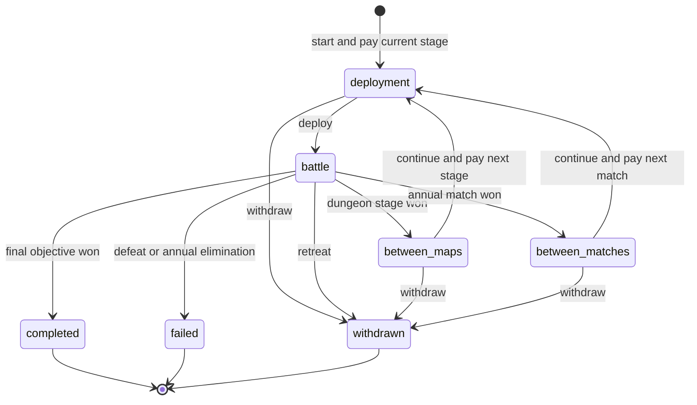

# 13 后端后续目标设计（未实现草案）

> 2026-10-16：合并远端 `b7d2b8f` 后保留的后续目标设计。当前可运行实现采用 Fastify、SQLite 与数字 op，接口以 [生成文档](agent-api.md) 和 `backend/common/protocol/ops.ts` 为准。本篇的表结构、版本号、commandId、报价、GET_CAPABILITIES 等都是后续方案，尚未接入现有 API，不得据此直接调用或宣称已实现。玩法以 [00](00-game-design.md) 为准，实现缺口见 [12](12-implementation-gap-checklist.md)，当前接入方式见 [14](14-integration-handoff.md)。

## 1. 不可破坏的约束

1. 账号有独立、单调增加的 `day`，起始0；无现实时间体力、追赶或赛季清空。
2. 一个账号最多一项未结束正式活动。单位／物品实例不能同时归属两个活动或两个持有人。
3. 正式野外、地区副本和大竞技场的己方普通角色真实死亡；神主角撤退；普通竞技场与练习暂用模拟副本。历史对手的变化永远不回写原账号。
4. 一条战斗动作的状态、死亡／盾消耗／耐久、经验、事件与幂等收据同事务提交。
5. 地区副本固定名单、跨图不自动恢复；年度赛事可使用报名时替补，已死者不能跨轮恢复。
6. 成长传承和数值传承互斥；每份遗产只使用一次，每名继承者只接一次。数值保底逐级兑现为可用属性，受逐项上限限制。
7. 年度比赛成绩不阻挡八章故事；赛事奖励与主线奖励使用不同唯一键。
8. 第一次讨伐只计不同地区，敌人不随玩家换装备、掉级或轮回自动缩放。
9. 随机候选、战斗、掉落、签表、成长只能由服务端创建并保存，查询／刷新不重掷。
10. 任何领取、生成、转移都有可追溯来源；金币／经验／材料不能负数，物品不能复制，已提交结果不能因请求超时撤销。

## 2. 数据模型与主键

主键使用服务端生成 UUID；目录ID是稳定字符串，不以名称作关联。数据库日期用非负 `bigint`，公开层限制为安全整数；事件游标是十进制字符串，不能在 JS 中转为浮点比较。真实时间使用 UTC `timestamptz`，仅用于会话、租约、报价与小游戏。

### 2.1 账号、配置与审计

| 表 | 核心字段 | 必需约束／索引 |
| --- | --- | --- |
| `accounts` | `id, display_name, status, created_at` | 显示名不当资源所有权凭证 |
| `sessions` | `id, account_id, credential_hash, expires_at, revoked_at` | 摘要唯一；按账号和到期时间索引 |
| `agent_credentials` | `id, account_id, credential_hash, scopes, revoked_at` | 摘要唯一；权限只由账号所有者赋予 |
| `players` | `id, account_id, setup_completed, day, version, active_run_id, ruleset_version, calendar_config` | `account_id UNIQUE`，`day>=0, version>=0`；初期每账号一个个人世界 |
| `rulesets` | `id, catalog_version, config_json, checksum` | 已使用版本不可原地修改 |
| `command_receipts` | `player_id, command_id, op, payload_hash, response_json, committed_at` | `PRIMARY KEY(player_id,command_id)`，摘要包含操作／数据／预期版本，不包含连接seq |
| `player_events` | `player_id, sequence, type, entity_id, player_version, payload_json` | `(player_id,sequence) UNIQUE`，仅追加；游标属于账号 |
| `outbox` | `id, player_id, sequence, topic, payload, lease_token, lease_until, delivered_at` | `(player_id,sequence,topic) UNIQUE`；未投递部分索引 |
| `audit_log` | `id, actor_id, action, subject_id, reason, receipt_id, created_at` | 写命令、管理补偿可追踪，敏感字段不进入payload |

### 2.2 军团、成长与继承

| 表 | 核心字段 | 必需约束／索引 |
| --- | --- | --- |
| `units` | `id, player_id, template_id, species_id, name, is_protagonist, status, class_id, level, exp, cycle, age_at_day_zero, lifespan_end_day, stats_json, caps_json, growth_json, hp, locked_run_id` | `level BETWEEN 1 AND 99, cycle IN(0,1)`；每玩家主角部分唯一索引；死亡／退役不物理删除 |
| `unit_skills` | `unit_id, skill_id, source, equipped_slot` | `(unit_id,skill_id) UNIQUE`；装备槽唯一，个人／职业能力单列 |
| `unit_proficiencies` | `unit_id, weapon_type, exp, rank` | `(unit_id,weapon_type) UNIQUE`；保存所有职业资格外的实际熟练度 |
| `growth_history` | `unit_id, cycle, level, rates_json, random_gains_json, inherited_gains_json, stats_after_json, rng_checkpoint_ref` | `(unit_id,cycle,level) UNIQUE`，首次一级基准另存；历史不可修改 |
| `unit_drug_usage` | `unit_id, cycle, stat_key, count` | `(unit_id,cycle,stat_key) UNIQUE`；总额由锁住角色后计算，不能只检查单项 |
| `legacies` | `id, player_id, source_unit_id, cause, source_level, source_stats_json, source_growth_json, state, recipient_unit_id, mode` | `source_unit_id UNIQUE`、`recipient_unit_id UNIQUE WHERE NOT NULL`；只能从available到claimed |
| `inheritance_contracts` | `legacy_id, recipient_unit_id, target_level, initial_total, source_total, clipped_target, caps_json, weights_json, cycle` | `legacy_id UNIQUE, recipient_unit_id UNIQUE`；固定预览中确认的上限／权重；轮回不重发 |
| `reincarnations` | `unit_id, source_cycle, target_cycle, base_stats_json, growth_allocation_json, receipt_id` | `unit_id UNIQUE`，仅0→1；基础值、药效清除和新额度同事务 |
| `memorial_records` | `unit_id, cause, at_day, battle_id, final_snapshot_json, lineage_json` | 战死、寿终、退役均记录，原因区分；不能重复产遗产 |

`age_at_day_zero` 允许招募者已有年龄；年龄为 `(age_at_day_zero + players.day)`，主角不衰老。寿终使用固定绝对行动日，不按现实时间扫描。随机角色与固定角色都是单位实例；固定人物额外用 `(player_id, template_id)` 的资格记录阻止再次招到本人。

### 2.3 物资、经济与生产

| 表 | 核心字段 | 必需约束／索引 |
| --- | --- | --- |
| `wallets` | `player_id, gold, bexp` | 主键player；两余额非负，与players同事务锁定 |
| `resource_balances` | `player_id, resource_id, quantity` | `(player_id,resource_id) PRIMARY KEY`，数量非负 |
| `item_instances` | `id, player_id, template_id, location, unit_id, run_id, durability, max_durability, uses_remaining, quality, refinement_resolved, bound` | 单个实例一个location；耐久 `0<=current<=max`；永久完美加成最多一次 |
| `economy_ledger` | `id, player_id, receipt_id, source_key, asset, delta, balance_after` | `(player_id,source_key,asset) UNIQUE`，来源细化到item或resource；不修改历史流水 |
| `shop_stock` | `player_id, shop_id, quarter_index, offer_id, remaining, version` | `(player_id,shop_id,quarter_index,offer_id) UNIQUE`，库存非负 |
| `recruit_encounters` | `id, player_id, region_id, kind, created_day, candidate_json, state, cost_receipt_id` | 同一encounter接受／拒绝只能一次，拒绝后不可再付钱复原同一人 |
| `recruit_pity` | `player_id, region_id, failures` | `(player_id,region_id) UNIQUE`，付时间后按结果更新 |
| `facilities` | `id, player_id, template_id, tier, capacity` | 工位由归属与配置验证 |
| `production_orders` | `id, player_id, facility_id, recipe_id, state, started_day, ready_day, input_ledger_ref, output_spec_json` | 活跃工位不超容量；产出模板在开工时固定，领取不能重抽 |
| `refinement_challenges` | `id, order_id, state, rules_version, armed_at, started_at, expires_at, stop_received_at, result_json` | `order_id UNIQUE`；一订单一结果，过期结果固定normal |
| `reward_claims` | `player_id, source_kind, source_id, reward_key, receipt_id` | `(player_id,source_kind,source_id,reward_key) UNIQUE`；不同commandId也不能重复领奖 |

材料是数量余额，武器、药品、盾、传承石是可锁定实例；不把“同名银剑”当成同一物品。药品有剩余次数，材料不占战斗携带栏。死亡装备先放 `memorial` 冻结，最终回收／损失策略未定前不直接删除或自动发回仓库。

### 2.4 地区、远征与战斗

| 表 | 核心字段 | 必需约束／索引 |
| --- | --- | --- |
| `region_progress` | `player_id, region_id, first_clear_day, first_clear_level, unlocked_tiers, local_objectives` | `(player_id,region_id) PRIMARY KEY`；首次通关仅一次 |
| `map_progress` | `player_id, stage_id, first_clear_day, best_rating` | 与地区计数分开，单图获胜不算整区讨伐 |
| `runs` | `id, player_id, kind, state, registration_day, region_id, stage_index, stage_count, risk_policy, experience_policy, recovery_policy, level_spec_json, ruleset_version, catalog_version` | 未结束状态按player部分唯一；结束后不可恢复为active |
| `run_units` | `run_id, unit_id, initial_json, carried_json, disposition` | `(run_id,unit_id) UNIQUE`；角色的locked_run_id与之对应 |
| `run_items` | `run_id, item_id, initial_json, carried_json, ownership_policy` | 同一真实item最多一个未结束run，模拟副本不关联第二份真实资产 |
| `run_stages` | `id, run_id, stage_index, state, generated_map_ref, enemy_spec_json, day_cost, battle_id` | `(run_id,stage_index) UNIQUE`；全部地图／敌人种子入场时固定 |
| `run_loot` | `run_id, drop_id, spec_json, status` | `(run_id,drop_id) UNIQUE`，pending→released或forfeited |
| `battles` | `id, run_id, stage_id, version, phase, status, engine_version, initial_private_json, current_private_json, public_checkpoint_json, result_json` | 一个stage一个battle；版本单调增长；私有状态绝不直接作为响应 |
| `battle_actions` | `battle_id, action_index, source, command_id, input_json, result_hash, events_json` | `(battle_id,action_index) PRIMARY KEY`，玩家commandId唯一关联；含AI动作 |
| `jobs` | `id, kind, entity_id, expected_version, state, lease_token, lease_until, attempts` | `(kind,entity_id,expected_version) UNIQUE`，有限重试与失败告警 |

`players.active_run_id`、`units.locked_run_id` 和物品锁的建立／释放与run状态同事务完成。跨账号引用通过应用层归属验证加组合外键兜底，不能仅凭UUID存在就允许操作。

### 2.5 赛事、快照、故事与见闻

| 表 | 核心字段 | 必需约束／索引 |
| --- | --- | --- |
| `defense_plans` | `id, player_id, version, map_id, slots_json, behavior_json` | 可修改的当前方案，不等于历史快照 |
| `arena_snapshots` | `id, player_id, captured_day, kind, ruleset_version, catalog_version, qualification_json, private_roster_json, public_roster_json, defense_json, content_hash` | 生成后不可变；匹配索引 `(kind,captured_day,ruleset_version)` |
| `arena_entries` | `id, player_id, kind, annual_index, run_id, snapshot_id, state, qualifier_wins, qualifier_count, bracket_size` | 大竞技场 `(player_id,annual_index) UNIQUE WHERE kind=annual`；普通竞技场每次独立entry |
| `arena_matches` | `id, entry_id, phase, round, slot, snapshot_a, snapshot_b, state, result_json, battle_id` | `(entry_id,phase,round,slot) UNIQUE`；签表节点结果只写一次 |
| `ratings` | `player_id, mode, progress_bracket, rating, matches` | 每场有效赛果唯一来源，不按纯累计场数排名 |
| `story_events` | `player_id, chapter, available_day, state, completed_day` | `(player_id,chapter) UNIQUE`，章节1–8，不含名次门槛 |
| `quest_progress` | `player_id, quest_id, state, progress_json` | 与主线年度事件分开；不通过随机文献阻挡主线 |
| `discoveries` | `player_id, discovery_id, discovered_day, context_ref` | `(player_id,discovery_id) UNIQUE`，可回看文本按目录版本渲染 |

不创建 `seasons / season_players / arena_days` 来驱动个人成长；现实榜单周期若加入，用独立排名配置，不接入个人日历和角色清空。

## 3. 日历与动作报价

### 3.1 显示与边界

默认草案 `year_length=120, quarter_length=30`。显示年份为 `floor(D/120)+1`，季度为 `floor((D%120)/30)+1`，年内日为 `D%120+1`。年度赛事编号与显示年份分开：第一届在累计D=120开放，即刚经历一年；第八届D=960，正常打满至978。API同时返回两种字段，UI不自行推算“当前届数”。

跨多日行动枚举区间 `(old_day,new_day]` 内所有边界，稳定按日期和事件优先级处理。建议同日顺序：寿终／资格变更→生产成熟→库存换季→年度赛事开放／故事事件→一般探索事件。纯读取只展示既有状态，不发新奖励或抽随机数。

### 3.2 报价与执行

`PREVIEW_ACTION` 返回与playerVersion绑定的 `quote_id`、实际耗日／金币／材料、开始结束日期、死亡风险、会遇到的日期事件和阻挡原因。报价生成可以保存短期报价行或签名数据，但不改变个人世界版本、不生成收益、不开战；不能把预测当成保底掉落。

`EXECUTE_ACTION` 锁玩家后重新验证报价、库存和活动状态，完整支付当前一步成本并推进日期；创建活动时记录推进前 `registration_day`，敌人按出发前已讨伐数量确定。若报价过期或版本变化，返回可刷新错误，不自动涨价后继续。

- 单场地图进入时支付本图全部日数，失败／退赛不退；三图远征不是入口一次收24日，后两图分别执行下一图报价。
- 年度报名先锁名单／快照并支付第一场两日，下一场再次明确支付两日；未打的轮次不收费。
- 所有活动参与者成长率使用本图出发时年龄。报价若发现出战者会在本图耗日区间自然寿终，阻止开图并提示先处理寿终／换人；不让寿终者以锁定快照继续参战。其他队员随日历正常寿终，完成纪念和遗产记录。
- 连战或赛事的下一场遇寿终时，先更新可用名单，允许撤离；副本不补人，赛事只能用原名单尚存活替补。不擅自把寿终改成战死。
- 一般等待一次最多一年，遇需要选择的剧情节点、寿终或赛事报名截止前可截停到最早节点；报价显示实际推进量。批量探索逐项提交／内部串行执行，不能一次跳过重要事件。
- 开始出征需要处理的游历候选等选择先解决；不会同时持有付过时间但未决招募与另一个正式远征。

### 3.3 招募、生产与库存

自捏开局锁住空players行，验证姓名、外观预设、九属性分配预算和两名初始伙伴资格；同事务生成唯一不死主角、两名伙伴与基础物资，再标记setup_completed。重复调用返回原幂等结果或已开局错误，不能重开免费刷初始属性。

游历推进四日后保存候选或失败，并更新地区保底；接受／拒绝不再扣日，拒绝不退四日。酒馆按当季库存直接支付金币、不推进日期；名册满时整个命令失败，不能先扣钱。固定人物领取额外检查招募资格唯一性。

生产开工先扣输入、消耗开工日，再设置 `ready_day=开工动作结束日+duration`。所有并行工位共享同一日期，绝不把并行等待相加。变为ready只代表可领取，仓库满时保留ready订单与输出；不丢东西，也不重复产出。

季度库存以个人quarter_index版本生成，打开商店不刷新；经过多个季度只保留当前库存，不把未购买库存累积送给玩家。领取生产与修理一般不额外推进日期，但受活动锁限制。

## 4. 活动与战斗状态机



同一个run只有一个当前stage。暂停仅断开连接／停止命令，不另建会恢复状态的“暂停副本”；任何状态查询都能恢复完整进度。`resolving`仅用于等待同一版本AI／结果任务，不能在该状态插入玩家操作。

### 4.1 真实资源投影

活动初始化复制战斗所需状态，但注明每项实体是 `owned_live` 还是 `simulated`。前者动作差额同步更新真实单位与物品，后者仅更新活动副本。副本中的HP与状态是当前活动的运行状态，真实角色记录同时保存其当前HP和死亡状态；禁止从报名初值整包覆盖真实单位。

普通模拟战结束可释放锁并丢弃模拟消耗；大竞技场或PvE绝不能复用该丢弃逻辑。对手被击败既不是当前玩家的遗产来源，也不导致对手原账号的角色死亡。

### 4.2 致死一击与不朽盾

每一击按：检查有效攻击／耐久→扣本击耐久→命中／技能／暴击／伤害→祈祷保护→不朽盾保护→最终生命状态。技能精确优先级随规则版本固定。触发盾时消耗一枚真实盾、保留1HP并立即石化；其后勇者／追击不能再造成伤亡。神主角最终生命状态为withdrawn，普通角色为dead或模拟defeated。

石化解除用明确的 `expires_at_player_phase` 标记，不用“剩余1回合”猜测当前阶段。阶段开始的持续伤害先在保护仍有效时结算，再解除，保证1HP单位有操作机会。石化占格、不可行动／反击，治疗和光环按当前草案禁用。阶段结束、地图结束和异常清理不能让死者恢复active。

### 4.3 三图地区大副本

- 入口固定队员实例和物品；三张地图的生成种子、敌人等级与装备档同时锁定；只有一个远征可在进行中。
- `carry_state`逐项带入HP、异常剩余时长、技能次数／冷却、物品次数、耐久与已死名单。合法换出生位置不等于换人；不触发额外阶段、地形回血或计时递减。
- 升级提高最大HP时不增加当前HP；杖、药与合法技能按实际动作恢复。中途不允许仓库、酒馆、生产领取、修理、转职、轮回或替补。
- 首领图胜利时才释放远征袋、写地区first_clear、增加不同地区讨伐数。经验逐图保留；撤离／失败使pending掉落forfeited，死亡和消耗保留。普通单图胜利按其独立奖励结算。
- 下一图需要合法部署人数；不足则显示原因并可撤离，不恢复死者凑数。主角撤退结束副本的规则先采用草案配置。
- 保存重载恢复同一run，不允许重新开图覆盖不满意的成长或掉落。

### 4.4 自由路线与动态等级

`C`从 `region_progress.first_clear_day IS NOT NULL` 计数；普通单图通关不加C。新远征出发时保存 `C_at_start` 和地区偏移δ：

```text
B = min(93, 5 + 8 * C_at_start)
L = clamp(B + delta, 1, 95)
normal = clamp(L + encounter_offset, 1, 99)
elite = min(99, L + 2)
boss = min(99, L + 4)
```

查看地区不锁低级难度，只有实际创建run锁当次配置。通关后低难重打保留该地区首次等级档；玩家主动选择的高阶任务另存tier，不覆盖原图。十二地区全部可按合法道路到达，编号不是解锁顺序。材料档、职业许可和高级配方另按总进度控制，先到龙谷不直接给满级角色。

## 5. 成长、传承、轮回与死亡

### 5.1 成长与上限

九属性使用 `hp,str,mag,skl,spd,lck,def,res,cha`；体格／移动单列。个人成长、职业、年龄、永久仪式加成与临时修正分字段保存，最终率最低0。每项基础增量为 `floor(rate/100)`，再按余数掷一次；超上限裁剪。默认不继承原型的两次空级重掷，是否启用普通空级保护留在规则配置中。

分配大量公共经验时逐级循环，依次记录自然成长与传承补点；1→99共98次，99级剩余经验固定0。随机流按角色实例与培养轮次固定，升级指令重试不得重掷。已离队／死亡角色不能接收公共经验。

### 5.2 遗产兑现

来源达标且战死、寿终或退役后生成一份available遗产，冻结来源基础成长与九属性总量。兑现事务：锁来源遗产、继承者、传承石和钱包→验证一级新角色／未接遗产／资格→计算预览一致的目标→扣道具与资源→写claimed和继承合同→更新继承者。

- 成长模式替换基础成长向量；不把来源职业、年龄、临时状态与本人轮回奖励永久化。继承修正另加并按成长上限裁剪。
- 数值模式设 `C=sum(recipient_caps)`、`target=min(source_total,C)`、一级总量S0、来源等级Ld；每级下限 `F(l)=S0+ceil(max(0,target-S0)*(l-1)/(Ld-1))`。先自然成长，再补差额，不修改随机率。
- 采用正整数权重，对尚有容量的属性按“当前已分补点／权重最小者”逐点分配，相同则按固定StatKey顺序；权重全零拒绝。每次重新选择尚有容量项，绝不丢弃剩余补点；同一级可向同项补多点。
- `Ld=1`直接补到 `max(S0,target)`；`target<=S0`无需补。每级与当前轮次唯一记录阻止重复兑现；来源200、总容量180时到对应等级只保证180，没有隐藏余额。
- 一个来源只能一份遗产，一个接受者只能一种模式；退役后寿终不再产第二份。后代再传时记录其实际总量，不把上一份遗产再加一次。

### 5.3 轮回与退役

轮回只允许存活、未锁定、99级且cycle=0角色。一次事务扣资源、保存轮回记录、清第一轮成长／药效／数值继承补点、恢复固定一级基准、cycle变1、按新cycle开放药剂额度；保留身份、年龄、寿命、已学技能／熟练度与职业资格，但实际职业仍满足新等级门槛。

成长率遗产保留为基础成长，个人轮回奖励独立分配且不跨代；数值遗产旧合同标记已结束，不在第二轮重新补。退役后不能参战、培养或再次传承；主角不可成为遗产来源，普通解雇不自动等于可传承退役。

## 6. 年度大竞技场与普通竞技场

### 6.1 报名与快照

大竞技场以annual_index唯一报名，先预览真实死亡风险并锁报名日、名单、培养数值、带入物品与规则。对手只筛选同类型、同报名行动日和兼容规则版本的历史快照；正赛优先有资格记录的玩家，且一签表不重复同一原账号。精确同日不足时用官方队伍，明确source，绝不悄悄使用较晚日期快照。

快照只记录真实存在过的状态，不倒填过去；报名时固化公开名册与隐藏防守设置。每轮继续用同报名日池，当前玩家的死亡、消耗和耐久跨轮保存。对手原账号不需要在线，不承担该局伤亡；快照被挑战也不自动产可用金币。

### 6.2 海选与64强

草案为三场海选至少两胜，打完三场后判断资格；未通过为eliminated。正赛64队单败，晋级64→32→16→8→4→2→1；全签表63个节点，玩家只打六轮。其他节点用规则AI模拟并保存结果，Worker重试不换胜者。

每届均从海选开始，前冠军无跳过资格。年度已报名entry一旦退赛／淘汰，当届不能重报；下一届重新海选。当前玩家可在每轮使用存活报名替补，不能招新或给报名名单外角色换入；局间仅恢复存活者HP和短期状态，永不恢复已死者／消耗盾／耐久。

保存／断线不取消entry。报名窗口需留至少整届18日，下一图或比赛每次重新验证日期和寿终；不得通过后端隐式跳日撞过已承诺赛事边界。BAN使用槽位实例ID，初期三人BAN=0；后期优先采用双方禁对手槽位，跨池通用防守BAN维度另作为配置，不按固定角色名误伤随机新人。

### 6.3 主线独立结算

八章按个人日历开放，不检查胜率、海选资格、名次或地区通关数。参赛结束即可完成当届主线事件；未报名按玩法草案在本届窗口结束后开放观赛摘要。预留调节未参赛结算时间的配置，但不得改成夺冠前置。

`COMPLETE_STORY_EVENT`仅将该章completed；`CLAIM_REWARD`按唯一奖励键领取团队1350公共经验。竞赛金币／荣誉使用arena_entry单独奖励键，普通竞技场不领取章节经验。退赛金币默认0；主线章节不会因退赛而失效，也不会因领奖路径不同重复发。

### 6.4 普通竞技场

每次三日，独立报名和快照副本；金币、积分取正式胜负，等级经验0，不能偷取真实对手装备。模拟消耗不写真实资产。重复参赛持续付个人时间；免费练习不发经济奖励。匹配按精确同日，榜单可按较宽进度段统计，两者字段分开。评分变更以match结果唯一结算，防守被多次挑战不自动发金币。

## 7. 完美锻造与其他小活动

正常生产与小游戏分离。订单ready后可普通领取，或先ARM一次精工挑战；ARM固定规则／奖励区与订单归属但不开始计时，START记录服务端真实开始时间，STOP记录服务端收到停止的时间并算位置。客户端不得提交“已完美”或任意时间戳作为结算依据。

网络延迟容错、Agent操作、前后端计时同步和输入体验仍需原型验证；首版 `features.refinement.enabled=false`，不能上线一个客户端随便报结果即可多发耐久的接口。启用后必须先通过双提交、超时、断线与延迟分布测试；时间校正上限由规则版本固定，不能由客户端扩大。

状态 `armed→running→resolved`；SKIP或超时固定normal；结果只写一次。生产订单领取必须等待挑战resolved或显式跳过；本件武器最多得到一次最大耐久+5，新品当前耐久同步+5。维修恢复到已有最大值，不能叠第二个完美奖励；失败不损坏已支付的正常成品。

小游戏的现实秒数不增加个人日历，且不存在脱离订单反复产材料的奖励入口。免费练习可以反复，但经济收益0。

## 8. 故障、权限与验收矩阵

以下是将来实现的必须测试项，当前不冒充已有集成测试：

| 场景 | 预期结果 |
| --- | --- |
| 同一出征命令超时后重发 | 返回原receipt，日历、扣物与地图只发生一次 |
| 相同commandId换负载 | `IDEMPOTENCY_CONFLICT`，无新状态 |
| 两个连接同时消耗最后一个盾 | 玩家／物品锁和版本使最多一个有效命令提交 |
| 击杀落库后API断线 | 重连仍死亡，遗产最多一份，不回到初始快照 |
| Worker在敌人第3个动作后崩溃 | 从已保存版本续第4个动作，之前伤亡不重复 |
| 连战转图／升级最大HP | 不自动回HP，不清异常，不重置道具／冷却 |
| 同一副本从两端继续下一图 | 只建一张battle、收一次八日 |
| 不同地区两种通关顺序 | C随不同首通数一致，δ和资源差异保留；全部区域可达 |
| 低级角色／卸装备／轮回后重新进图 | 不降低未讨伐地区的进度等级 |
| 多级公共经验、连续空级、容量180的200点遗产 | 每级及时补，终点180且无单项超限，无重载重复补点 |
| 两个请求同时抢一份遗产或两模式兑现 | 唯一约束与事务保证只能一位、一种模式 |
| 同一角色退役后再寿终 | 保留历史，不生成第二份遗产 |
| 轮回时药剂额度和属性 | 第一轮药效移除，额度重置一次；旧数值遗产不重新补 |
| 第八届海选出局／主动退赛 | 主线事件照常可完成，真实死亡不恢复 |
| 历史对手被多玩家打败 | 原账号单位／日期／金币不变 |
| 尚有精工挑战时重复领取／STOP | 一次结果、一件成品、最多+5，无零时间无限产物 |
| 一个等待跨多个季度／寿终／赛事边界 | 区间事件全处理，危险节点按报价截停或阻挡 |
| 事件推送丢失、重复、乱序 | 按cursor补拉，重复丢弃；最终状态可全量重建 |
| 非本人battle／unit／order／legacy | 统一无权限／不存在响应，不能探测私有内容 |
| 规则版本热更且仍有进行中run | 老run按固定版本完成，新run采用新版本 |

## 9. 当前交付与尚未实现

当前主分支已有远端实现的服务端、SQLite 存档及已接入的前端，验证包含引擎、成长、竞技场、协议、API、Worker 结算、地图工具和浏览器联调；具体范围见14。本文不是这套代码的数据字典，也没有要求先重写已存在的模块。后续应按12的缺口逐项扩展现有代码，并在每项落地时补状态迁移与验收。

此前独立的 v2 契约、客户端、mock、31项测试及完整原设计保存在本地备份分支 `codex/local-v2-before-remote-20261016`（提交 `464aaae`）。它们未接入当前数字 op 服务端。可参考其中的命令恢复、状态版本与跨图状态设计，不能把两套客户端同时接到页面。合并任务由 Beads `fe-world-fgb` 记录。
