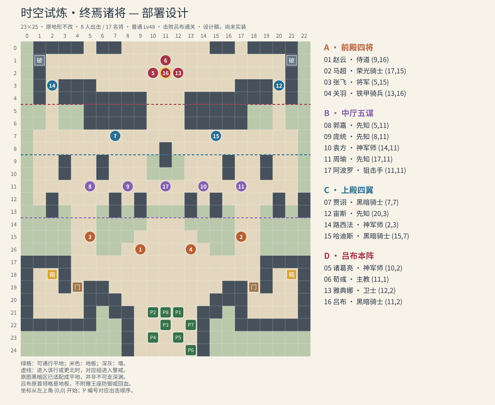

# 39 时空副本：48级面板与终焉诸将地图设计

关联：[37 已确认规则](37-hidden-content-cross-time-recruit.md)、[38 职业／成长／个人特性](38-cross-time-generals-draft.md)。

**状态：数值试算与地图设计完成；时空副本与固定兑换已获准作为下一步实现，当前尚未完成。** 阿波罗 `lightshot` 光明神射及可选 `personalSkill` 持久化覆盖／战斗快照的引擎与前端支持已实现，不代表副本或招募已经开放。 本文补齐一级基础值、20级生成口径、48级估值、普通／困难配置、站位、警戒、装备和奖励。除第37篇规则及本次明确允许移除原怪物增援、定时石化外，新增参数属于本版设计选择，不冒充已上线或实战平衡结论。

## 1. 计算口径

- 一级基础仍为原来的 **70点**，用于20级招募模板和之后的正常成长，职业／个人成长均不变。
- **本次每人至少＋20只强化时空副本敌军：其余16人各＋20，吕布＋24。** 加成独立保存在 `enemyBonus`，在敌方按等级计算完面板后加一次；不写入招募基础、个人成长或玩家永久面板。招募时重新按原20级模板生成，也不保留困难模式的等级、体格或倍率强化。
- 职业和个人成长完全沿用第38篇；全年龄成长型每项＋5。实际率为 `max(0, 个人成长＋职业成长)＋5`。本名单没有其他成长加成。
- 为给固定兑换一个稳定起点，**20级入队面板固定取均值并四舍五入**；之后照现有随机升级与空级保护走。前19级使用入队职业成长作数值折算，不虚构已经走过的低阶转职路线，也不随兑换附送其他职业资格。
- 每项小数成长率为 `r`，空级概率 `p0=∏max(0,1-r)`；空级最多重掷两次，故单级期望增量为 `r×(1+p0+p0²)`。
- `20级招募固定值=round(一级基础＋19×单级期望)`；`招募版培养到48级的期望=20级固定值＋28×单级期望`；`普通敌军48级=round(该期望)＋enemyBonus`，HP按150上限处理，其他八项不截断。本表展示最后的敌军值；玩家培养结果会波动，且始终不含 `enemyBonus`。不能把1→48误算成48次升级。
- 无装备面板加成、传承、轮回、药、随机特性触发或战斗光环。HP上限150，其余八项无99上限；已验证这一等级段连理论全成功路径也不会触及HP上限，因此上述期望公式适用。
- 概率特性另外结算：吕布触发时力／魔分别＋10；马超速度＋10；郭嘉技巧＋10。不能把33%折成永久面板＋3.3，也不能把吕布的力魔两项直接相加当攻击力。

计算使用当前 `CLASSES` 和 `applyGrowthBonus`；另调用真实 `rollLevelUp`，每人模拟5,000次20→48成长，共 **85,000条培养样本**，九项样本均值均与解析值相差不到0.25点。结果可复算：`node design/cross-time/calculate.mjs`。这是成长校验，不是战斗胜率测试。

## 2. 17人的48级敌军面板

**含本次敌方额外加成，不含装备和交战临时加成。招募版不使用这张表；其20级面板与培养到48级的均值保留原版。**

| 人物 | 职业 | HP | 力 | 魔 | 技 | 速 | 运 | 防 | 魔防 | 魅力 |
| --- | --- | ---: | ---: | ---: | ---: | ---: | ---: | ---: | ---: | ---: |
| 赵云 | 侍道 | 63 | 42 | 5 | 50 | 54 | 28 | 22 | 18 | 22 |
| 马超 | 荣光骑士 | 70 | 52 | 2 | 35 | 45 | 21 | 29 | 17 | 22 |
| 张飞 | 将军 | 88 | 56 | 2 | 32 | 18 | 13 | 58 | 9 | 19 |
| 关羽 | 铁甲骑兵 | 77 | 56 | 2 | 36 | 27 | 16 | 43 | 14 | 23 |
| 诸葛亮 | 神军师 | 54 | 16 | 52 | 52 | 32 | 25 | 20 | 35 | 22 |
| 荀彧 | 主教 | 51 | 3 | 49 | 32 | 25 | 44 | 14 | 56 | 30 |
| 贾诩 | 黑暗骑士 | 59 | 11 | 52 | 42 | 33 | 34 | 23 | 33 | 19 |
| 郭嘉 | 先知 | 44 | 3 | 60 | 51 | 49 | 21 | 8 | 38 | 19 |
| 庞统 | 先知 | 58 | 3 | 60 | 52 | 24 | 17 | 17 | 43 | 19 |
| 袁方 | 神军师 | 60 | 32 | 42 | 47 | 31 | 19 | 26 | 29 | 22 |
| 周瑜 | 先知 | 55 | 13 | 57 | 46 | 36 | 24 | 17 | 32 | 24 |
| 宙斯 | 先知 | 60 | 9 | 65 | 41 | 30 | 27 | 17 | 32 | 22 |
| 雅典娜 | 卫士 | 63 | 39 | 15 | 34 | 26 | 21 | 42 | 40 | 21 |
| 路西法 | 神军师 | 57 | 42 | 42 | 39 | 48 | 13 | 22 | 25 | 18 |
| 哈迪斯 | 黑暗骑士 | 69 | 14 | 56 | 37 | 18 | 22 | 35 | 42 | 18 |
| 吕布 | 黑暗骑士 | 69 | 47 | 46 | 37 | 24 | 12 | 34 | 32 | 16 |
| 阿波罗 | 狙击手 | 55 | 41 | 8 | 59 | 44 | 34 | 18 | 22 | 22 |

- **吕布**：本次 HP＋4、力＋5、魔＋5、技＋2、双防各＋4，合计＋24；现在力47／魔46、双防34／32，33%爆发触发时力57／魔56。保留速度24与幸运12的取舍。
- **赵云、马超、关羽、张飞**：分别偏高速护卫、高速骑袭、力量重骑、极端物理壁垒。张飞本次 HP＋6、力＋5、技＋3、防＋6；魔防9仍是明确的解法。
- **荀彧**：本次 HP＋4、魔＋5、技／速各＋2、防＋3、魔防＋4；现在魔防56、运44、物防14，保留单体治疗距离＋1。
- **郭嘉／庞统／宙斯**：魔60／60／65；郭嘉速49、HP44、防8，庞统慢而能减速，宙斯偏雷法威力。其余加点也按各自定位，未增加魅力、幸运或无用途的副攻属性。
- “速”是裸速度；实际攻速还受武器重量、个人体格及现有职业规则影响。例：赵云用重10银枪、体格8时，常规重量项会扣2攻速；不能直接把表中的54当所有配装的攻速。

## 3. 副本总览

这是按**游戏当前可玩地形**绘制的部署示意，不是声称抽取了原作完整美术图。

| 项目 | 本版设计 |
| --- | --- |
| 名称 | 时空试炼·终焉诸将 |
| 入口 | 第1000日起，任意已开通地区可见同一个通用任务；领取／完成状态跨地区共享 |
| 地图 | 单图，复用 `fe8-chfinal-1-eirika`，23×25 |
| 玩家 | 最多8人，沿用原8格及玩家自定出击顺序，第一位为主将 |
| 敌军 | 17名将全部开局在场并可查看，吕布是唯一 `boss=true` |
| 普通 | 全员固定48级，使用本章表值；不按日期继续抬级 |
| 困难 | 普通首通后解锁；全员52级，详见下节 |
| 耗日 | 每次出发8日；失败／撤离不退，读档／重试不重复扣 |
| 时限 | 40回合；目标体验18～26回合只是调试目标，尚未实战证明 |
| 胜利 | 吕布被击败且战斗结果为玩家胜；不要求全歼其余16人，不改成占领王座 |
| 失败 | 沿用主将战败、全军覆没、回合超时、主动撤离等既有判定；没有免费复活规则 |
| 难度定位 | 第3年开始出现的可延后挑战；建议45～50级、成型配装，建议值不作为额外入场门槛 |

48级名将比第3年年初约35级培养目标强很多。入口开放不等于当天就应能通过；玩家可继续成长再来，不通过暗降敌人属性掩盖等级差。

### 困难模式

- 仍是同一17人、同样站位和警戒规则；不复制名将、不补无名杂兵。**这是手工名将阵容的专用配置**，不套用普通随机副本的“人数＋50%”，也不改变其他地图规则。
- 先按原固定20级面板算到52级并取整，加一次该人的 `enemyBonus`，再将 HP×1.25、其他八项×1.15，向上取整，HP最高150、其余八项不设上限；体格＋2，移动不加。公式、逐人结果见 `design/cross-time/levels.json` 的 `hard52`，不能重复套用通用困难强化。以上全部为敌方专属，兑换入队一律回到原20级模板。
- 使用既有困难AI的有限前瞻与协同，行动仍受待命状态约束。配装与施法次数沿用普通表，不把概率爆发与勇者连击同时堆给整队。
- 难度差由固定等级、固定强化和AI体现；玩家出发前能看到准确面板。3种个人概率特性仍为33%，不在困难偷偷抬高。
- 困难首通装备奖励单列；碎片仍20%，不翻倍，也不再次发通用解锁任务的3枚。

## 4. 原地图的保留与移除

**保留底图、尺寸、8个出击点及6个原物件；仅在时空任务的独立配置里替换36个原敌人为17名将。** 出发时仍沿用已有季节冻结规则；冬季原适配平地可能变雪地，石地板不变，不新增时空专用地形变化。

出击顺序：`P1(12,21)、P2(10,21)、P3(11,22)、P4(10,23)、P5(12,23)、P6(13,24)、P7(13,22)、P8(11,21)`。

| 原物件 | 位置 | 保留规则 |
| --- | --- | --- |
| 左／右房门 | (4,19)／(18,19) | 相邻交互开门；现有规则不要求钥匙或盗贼 |
| 左／右宝箱 | (2,18)／(21,18) | 分别银剑×1、银斧×1；沿用普通场景宝箱规则，开箱暂存，完整通关入库 |
| 左／右破墙 | (1,1)／(21,1) | 24HP，可破坏后通行 |

**已获用户同意，时空版移除：**

1. `wave-group-916164`：第2回合三个龙骑兵增援。
2. `status-21-20`：第3回合从(21,20)发动的定时石化。

不保留这些事件的伤害／异常，也不换成另一种隐藏惩罚。没有新增援、机关、刷怪或剧情无敌。共享经典副本、远征、挑战塔使用的原配置不在此处修改。

**真实通道：**中央出生走廊逐渐向北扩宽；上殿正门 `(10～12,4～6)` 是3格宽通道，左右另有 `(2,3～6)`、`(20,3～6)` 单格侧路。中段有多个开口，不能宣称必须过左右两座桥。原作黑暗区在当前适配中是可走的 `plain`；本案保留这一事实，不画不可见墙强迫玩家走预设路线。

**吕布格(11,2)是floor**，可以骑乘站立，没有王座回避、防御或每回合回血。魔法和远程合法范围仍按现行规则预览，不能把美术上的柱墙自动当作视线阻挡。

## 5. 完整部署与配装

坐标为左上角0-based `(x,y)`；编号对应地图圆点。武器／法术精确ID、次数见 `design/cross-time/map-plan.json`。

| 编号 | 组 | 人物 | 坐标 | 激活后行为 | 普通／困难配装 |
| ---: | --- | --- | --- | --- | --- |
| 01 | A | 赵云 | (9,16) | 伺机攻击 | 银枪、银剑 |
| 02 | A | 马超 | (17,15) | 伺机攻击 | 银枪、短枪 |
| 03 | A | 张飞 | (5,15) | 伺机攻击 | 银枪、短枪 |
| 04 | A | 关羽 | (13,16) | 伺机攻击 | 银斧、短枪 |
| 05 | D | 诸葛亮 | (10,2) | 护卫吕布 | 银剑；风刃 12 次 |
| 06 | D | 荀彧 | (11,1) | 优先治疗 | 治疗杖 6 次、恢复杖 3 次；光术 12 次 |
| 07 | C | 贾诩 | (7,7) | 伺机攻击 | 暗术 12 次 |
| 08 | B | 郭嘉 | (5,11) | 伺机攻击 | 雷霆 12 次、风刃 10 次 |
| 09 | B | 庞统 | (8,11) | 伺机攻击 | 暗术 12 次 |
| 10 | B | 袁方 | (14,11) | 伺机攻击 | 银剑；雷霆 12 次 |
| 11 | B | 周瑜 | (17,11) | 伺机攻击 | 烈火 10 次、火焰 12 次 |
| 12 | C | 宙斯 | (20,3) | 伺机攻击 | 雷霆 15 次 |
| 13 | D | 雅典娜 | (12,2) | 护卫吕布 | 银枪 |
| 14 | C | 路西法 | (2,3) | 伺机攻击 | 银剑；风刃 12 次 |
| 15 | C | 哈迪斯 | (15,7) | 伺机攻击 | 暗术 12 次、吸血术 8 次 |
| 16 | D | 吕布 | (11,2) | 伺机攻击 | 银剑；暗术 12 次 |
| 17 | B | 阿波罗 | (11,11) | 伺机攻击 | 银弓、长弓 |

- 本阵初始排成吕布居中、诸葛亮与雅典娜左右相邻、荀彧在后方的阵形：诸葛亮2格光环可覆盖其他三人，雅典娜满足相邻友军条件，荀彧的2格单体治疗能照顾两侧护卫；密集站位也明确给玩家范围攻击的反制机会。
- 物理武器熟练度设为对应类别A；黑／暗法术设理A、白魔法与杖设杖B，仅给实际所需类别。职业权限仍必须满足，不能因名将身份使用非法武器。
- 杖与法术书次数是战斗实例的有限资源；普通物理攻击沿用现有免费规则。普通武器初始满耐久，不附送武器战技、已装备的习得技能或额外个人技能。现有职业固有能力照常生效，17人自己的唯一个人特性用第38篇。
- 雅典娜作为本阵护卫，本次敌方配装只带枪；玩家招募后仍有职业原本的杖权限。避免把杖塞进普通护卫AI后假称它会主动治疗。
- 荀彧不带远疗、群疗、救援、传送；待命时不主动治疗，D组激活后按现有治疗AI行动，可以支援还活着的其他组、跟随战线，不伪称AI已有“只治疗本组”的限制。
- 吕布**激活后能移动并主动选剑／暗术进攻**，使用伺机行为，不能用当前只会等待的 `hold` 冒充原地主动攻击。他会离开原首领格；诸葛亮、雅典娜按既有guard逻辑护卫他。正常反击按当前持有装备与合法射程，不给吕布免费切换最优物魔反击的特权。
- 阿波罗放在开阔中厅，具有横向退射空间；不放在封死的一格洞里。银弓原射程2、长弓2～3；第38篇已定案并实现的 `lightshot` 光明神射在交战开场满血且实际用弓时，将既有战技增益后的有效技巧翻倍，敌我主动、合法反击、勇者连击、追击及战技技巧触发／返还判定均适用；命中、必杀与触发概率仍限制在0～100%，`noCrit` 不变。它不改变永久属性或射程，也不附送近战反击或战技；下次交战受伤失效、补满恢复。所有攻击法术1～2格。副本接入须沿用该技能的运行时规则与前端支持。

## 6. 四组推进与明确警戒

四组是组织战斗的方式，不是要求按固定顺序清空地图。玩家可以分路、同时拉组或直接突破吕布；这会改变需要同时面对的敌人数。

| 组 | 常规交战阶段 | 玩家应处理的问题 |
| --- | --- | --- |
| A 前殿四将 | 赵云、马超、张飞、关羽 | 物理前排的不同弱点；用法术对付张飞，不在马超33%速度爆发下只看平均追击 |
| B 中厅五谋 | 郭嘉、庞统、袁方、周瑜、阿波罗 | 分散远程威胁；郭嘉脆、庞统减速、袁方借夹击、周瑜火法、阿波罗远射 |
| C 上殿四翼 | 贾诩、哈迪斯、路西法、宙斯 | 左右都能进；暗骑补刀与续航、侧道混合／雷法；绕路会接近其射程 |
| D 吕布本阵 | 诸葛亮、雅典娜、荀彧、吕布 | 光环、护卫与有限治疗支持双修骑士；优先断后勤或在安全窗口集中斩首 |

### 激活规则（新增设计，当前引擎没有完整实现）

1. 所有17人开局可见。待命角色可以被攻击并正常反击，不无敌、不回血重置；但不移动、不主动攻击或治疗。
2. **A组固定从第2个敌方阶段开始行动。**准备页和开局日志明确显示；第1回合给玩家整队空间。提前攻击仍有正常反击，不提前这一固定计时。
3. B／C／D分别在任一玩家存活单位进入 `y≤13`／`y≤8`／`y≤4` 时进入警戒；每组也可由“前组全灭”或“本组遭到玩家攻击／敌对法术”触发。三条件取OR，未命中也算交战；传送、强制位移后的落点也检查，不能只监视普通走路。
4. 警戒在当前动作结算后记录。若发生在玩家阶段，则**紧接着的本回合敌方阶段**激活；若发生在敌方阶段，则下一回合的敌方阶段激活。不让原本待命的单位在当前敌方阶段中途插队行动。
5. 分界线与“激活后的移动＋攻击范围”在准备、移动预览和敌方信息里可见；跨线或攻击待命组时提示“该组将在下一敌方阶段行动”，标明回合数。不能在玩家行动后才第一次揭示危险。
6. 一次动作可能唤醒多组，逐组记录；组已激活则不重复触发。清空上一组但下一组本就全灭时继续检查后继；已经死亡的单位不重生。吕布死亡导致战斗结束时停止后续行动与触发。
7. 激活后的A/B/C及吕布使用现有伺机AI：只有能移动到合法攻击点时进攻，否则等待，不凭“激活”获得额外行动或全地图追踪。D的护卫和治疗照表执行。困难规划也必须排除仍待命的人。
8. 存档保存每组状态、触发原因、激活敌方回合号与一次性通知；重连、回放、命令重试不能重抽、重复通知、刷新治疗次数或挪动兵力。

当前scenario只有turn/object/flag触发，**没有上述越线、组员全灭、遭到攻击、切换行为的完整组合**。实装需要一个按这些固定规则运行的分组状态，不做通用剧情编辑器，也不能仅改几行静态JSON后就声称分阶段已完成。

## 7. 奖励、碎片和重复挑战

原第37篇的3枚解锁奖励与后续20%掉落不变；按本案，完整胜利后统一入库。任务通关自动完成并发放首次奖励，不再要求额外按一次领取，也不允许另一路任务领取重复发放。

| 情况 | 固定通关奖励 | 时空碎片 |
| --- | --- | --- |
| 全账号首次普通通关 | 金币2500、银剑×1、伤药×2；解锁固定兑换及本图困难 | 固定3枚；本次不额外抽20% |
| 后续普通胜利 | 金币800 | 每次独立20%给1枚 |
| 本图困难首通 | 金币3500、勇者之剑×1、完整料理×2 | 属于通用任务完成后的胜利，20%给1枚；不会再给固定3枚 |
| 后续困难胜利 | 金币1500 | 每次独立20%给1枚 |

- 表中首通金币替代重复金币，不相加。普通／困难装备首通资格各自独立，不掷装备概率。
- 两个原场景宝箱与表中通关奖励是独立来源，沿用经典地图固定宝箱规则，可每次挑战开取；必须胜利才带走。敌方17人的携带装备不逐件掉落。首通奖励无需为它额外开箱。
- 碎片每场最多判一次，只有吕布计入，不按其他16名名将的击杀逐个判。抽取结果与战斗胜利结算固定，断线重试不重抽。每次真正重新出发支付8日后，才是新的独立挑战。
- 本图的招募解锁、吕布击败资格、首通标记、掉落与战斗收据一起按既有事务方式落库；失败、撤离、非玩家胜利都不发。常规战斗经验和死亡结算仍遵从现有规则，不给另外16人套用boss额外经验。
- 20%没有保底：后续攒满3枚平均需15次胜利，即120日；换完首名后再换两名，平均约30次胜利／240日。平均值不保证次数，不提高困难掉率或新增每日免费抽取。
- 通用任务在各地区只是同一个入口，不重复给地区探索度或声望；兑换继续遵守3名同时在队、每个身份账号仅一次、20级成长型、死亡／轮回／退役等既定规则。

## 8. 一级分配与体格

顺序为 **HP／力／魔／技／速／运／防／魔防／魅力**；以下是原本的**招募基础向量，每人合计70，完全不含敌方强化**。移动是职业原始值，不把体格算成防御或成长点。招募年龄仍在20～30范围，具体人物年龄未在本次地图设计中强行定死；成长型的＋5不因选该范围内哪一岁而改变。

| 人物 | 一级基础向量 | 体格 | 职业基础移动 |
| --- | --- | ---: | ---: |
| 赵云 | 22 / 8 / 0 / 9 / 10 / 6 / 6 / 4 / 5 | 8 | 5 |
| 马超 | 24 / 10 / 0 / 7 / 10 / 4 / 7 / 3 / 5 | 10 | 6 |
| 张飞 | 28 / 11 / 0 / 5 / 4 / 3 / 12 / 2 / 5 | 14 | 4 |
| 关羽 | 25 / 11 / 0 / 8 / 6 / 4 / 9 / 3 / 4 | 13 | 5 |
| 诸葛亮 | 18 / 2 / 10 / 11 / 7 / 6 / 4 / 7 / 5 | 6 | 5 |
| 荀彧 | 17 / 1 / 9 / 6 / 6 / 9 / 4 / 12 / 6 | 5 | 5 |
| 贾诩 | 19 / 1 / 10 / 9 / 7 / 9 / 4 / 6 / 5 | 6 | 6 |
| 郭嘉 | 16 / 1 / 12 / 10 / 11 / 4 / 3 / 8 / 5 | 4 | 5 |
| 庞统 | 19 / 1 / 12 / 10 / 5 / 3 / 5 / 10 / 5 | 5 | 5 |
| 袁方 | 20 / 5 / 8 / 10 / 7 / 5 / 5 / 5 / 5 | 7 | 5 |
| 周瑜 | 19 / 3 / 11 / 9 / 8 / 5 / 5 / 5 / 5 | 7 | 5 |
| 宙斯 | 21 / 2 / 13 / 8 / 6 / 5 / 5 / 5 / 5 | 10 | 5 |
| 雅典娜 | 22 / 8 / 3 / 7 / 6 / 4 / 9 / 7 / 4 | 10 | 5 |
| 路西法 | 19 / 8 / 8 / 8 / 11 / 3 / 4 / 5 / 4 | 8 | 5 |
| 哈迪斯 | 22 / 2 / 11 / 7 / 4 / 5 / 7 / 8 / 4 | 10 | 6 |
| 吕布 | 23 / 9 / 8 / 7 / 5 / 2 / 6 / 6 / 4 | 13 | 6 |
| 阿波罗 | 19 / 9 / 1 / 11 / 9 / 9 / 3 / 4 / 5 | 8 | 5 |

招募20级固定面板（`level20`）、招募版培养到48级的均值与取整（`mean48`／`recruit48`）、敌方专属加成（`enemyBonus`）、普通敌军48级（`normal48`）及困难敌军52级（`hard52`）均在 [levels.json](../design/cross-time/levels.json)。可编辑输入是 [roster.json](../design/cross-time/roster.json)；必须按字段区分阵营用途，不能把敌军表作为招募模板。

每人的个人特性属于身份设计，敌我按同一规则使用；按尚待实现的招募设计，阿波罗入队保留已实现的 `lightshot` 光明神射。此次明确不保留的是副本额外属性与困难强化。

## 9. 校验与实装范围

已校验：17人职业／成长与第38篇一致；原一级70点、20级招募面板及招募版48级均值保持不变；普通敌军在原48级表上各净增20点（吕布24），加成不泄漏到招募数据；真实成长函数85,000条样本；17敌人和8出生点共25个格子不重叠、不占物件、职业可站；保留关闭门／完整破墙时，从出生区仍可到达所有敌人（373个可达格）；全部武器与法术职业权限、次数合法；只有吕布为boss。底图SHA与物件快照见 [map-validation.json](../design/cross-time/map-validation.json)。

复算：`node design/cross-time/calculate.mjs`；地图与装备核对／重画：`node design/cross-time/check-map.mjs`。脚本仅生成设计文件，不写玩家数据库或游戏运行时目录。

实装须触及：任务可见性与通用完成标记、固定敌军构建（不能再叠原经典difficulty／stageBonus／bossBonus／spread）、其余个人特性与概率预测（阿波罗 `lightshot` 及个人技能覆盖／快照已有支持）、分组激活及敌方AI过滤、场景事件白名单、难度专用强化、物件与战利品、胜利事务／命令重试、API与MCP合法行动及预览、准备页／战斗提示／回放、自动化测试。原地图在经典副本和挑战塔的行为保持其原配置。

**尚未验证：**玩家队伍实际通关率、18～26回合体验目标、三名将队伍与装备组合、个人特性的实战收益。正式实装后要测同级队伍、35级提前挑战、长弓／沉默／传送绕行、冬季移动、同时触发多组、同归于尽、失败与重试，不以静态连通性或成长均值替代战斗平衡测试。
